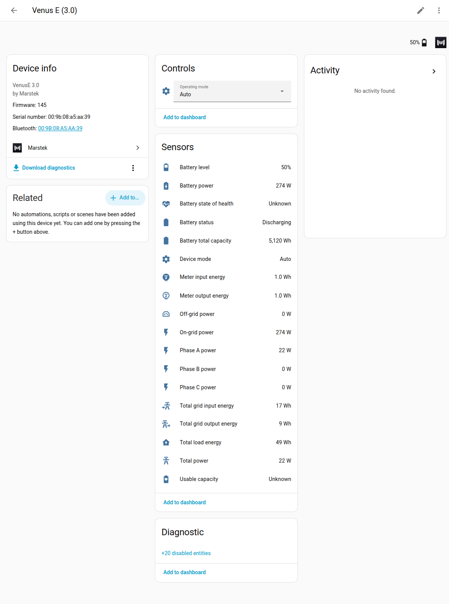
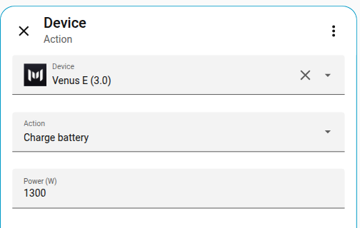

# Marstek Home Assistant Integration

[](https://opensource.org/licenses/MIT)
[](https://www.home-assistant.io/)
[](https://hacs.xyz/)
[](https://marstek.rhino-inquisitor.com/)

Monitor and control Marstek batteries from Home Assistant over local UDP. Read live state of charge and power, send solar and grid energy to the Energy dashboard, set the operating mode, and drive passive power or manual schedules from automations. Usable capacity and battery health are optional once a pack has been measured. See [Battery health](docs/usable-capacity.md).

This is an independent community project. It is not affiliated with or endorsed by Marstek.

**New to this?** The documentation website at **[marstek.rhino-inquisitor.com](https://marstek.rhino-inquisitor.com/)** has a step-by-step [getting started guide](https://marstek.rhino-inquisitor.com/guide/getting-started), a [supported devices](https://marstek.rhino-inquisitor.com/guide/supported-devices) check, and a [comparison with other integrations](https://marstek.rhino-inquisitor.com/guide/comparison).

## See it

The device page shows state of charge, power, operating mode, and the controls. An automation can charge, discharge, or stop the battery with a device action.




Setup, options, and the Energy dashboard are in the [visual tour](docs/screenshots.md). The Runs tab, the Energy tab, the phone layout, and the card picker are in [Battery health](docs/usable-capacity.md) and that tour.

## Quick start

1. In the Marstek app, enable **Open API** on the battery. Home Assistant has to be on the same network. The usual port is **30000**.
2. Install the integration with [HACS](#installation) (or copy it in by hand) and restart Home Assistant.
3. Go to **Settings → Devices & services → Add integration**, search for **Marstek**, and pick the discovered battery. If nothing is found, enter the IP address and port.

Polling intervals, power limits, and the optional Battery health sidebar are under **Configure** on the device. See [Options](#options).

## Installation

### HACS (recommended)

1. Open **HACS** in Home Assistant.
2. Open the three-dot menu and choose **Custom repositories**.
3. Add this repository's URL and choose **Integration**.
4. Search for **Marstek** and install it.
5. Restart Home Assistant.

### Manual installation

Copy `custom_components/marstek` into your Home Assistant config as `config/custom_components/marstek`, then restart.

```bash
cd /config
mkdir -p custom_components
cp -r /path/to/has-marstek-local-api/custom_components/marstek custom_components/
```

### Removing the integration

1. Go to **Settings → Devices & services**.
2. Open **Marstek**.
3. On the device, open the three-dot menu and choose **Delete**. Repeat for each battery. Each battery is its own config entry.
4. Deleting the entry removes its device, its entities and their history, releases the UDP socket, and clears Repairs issues that entry raised. The network scanner stops once the last entry is gone.

To remove the integration as well:

- **HACS**: **HACS → Integrations → Marstek →** three-dot menu **→ Remove**, then restart Home Assistant.
- **Manual install**: delete `config/custom_components/marstek/` and restart.

**Open API** can stay enabled in the Marstek app. A battery you delete while it is still on the network is offered again under **Settings → Devices & services**. Choose **Ignore** on that discovery card to leave it out.

More detail: [Installation](docs/installation.md).

## What you can do

- **Live battery state.** State of charge, charge and discharge power, status, and operating mode (Auto, AI, Manual, Passive, and UPS on firmware that supports it).
- **Control from automations.** Charge, discharge, and stop device actions, plus `marstek.set_passive_mode` and manual schedules (`0–9` on Venus A, C, D, and E, `0–5` on Venus E mini).
- **Energy dashboard.** Grid and off-grid power, per-phase meter power, solar PV on Venus A and Venus D, and lifetime energy totals.
- **Device controls on supported firmware.** Depth of discharge, Bluetooth advertising, and the panel LED.
- **Finding and diagnosing the battery.** Wi-Fi RSSI, CT connection status, automatic IP discovery, diagnostics, and Repairs.
- **Battery health, optional.** Usable capacity, state of health, the built-in Lovelace cards, the sidebar dashboard, and a linked smart-plug meter. See [Battery health](docs/usable-capacity.md).

**Battery temperature** and the other battery-detail sensors start disabled, because the request behind them has been suspected of resetting some batteries ([#14](https://github.com/taurgis/has-marstek-local-api/issues/14)). Enable them from the device page when you want them. See [Entities](docs/entities.md).

## Use cases

- **Dynamic tariff arbitrage.** Drive `marstek.set_manual_schedule` from a price integration (Nord Pool, Tibber, EPEX) so the battery charges on cheap hours and discharges on expensive ones.
- **Closed-loop power.** `marstek.set_passive_mode` sets a watt setpoint with a countdown, so an automation can follow house load or a solar forecast.
- **Solar self-consumption.** On Venus A and Venus D the PV sensors feed the Energy dashboard. See [Energy dashboard](docs/energy_dashboard.md).
- **Grid-peak avoidance.** Meter sensors expose import and export per phase, so an automation can discharge when the house would otherwise set a new peak.
- **Make room for an EV or a heat pump.** **Charge**, **Discharge**, and **Stop** are device actions in the automation editor.
- **Alerts without a cloud account.** State of charge, temperature, firmware, and Wi-Fi RSSI stay available when Marstek's servers do not.

Copy-paste YAML is in [Automations and services](docs/services.md).

## Requirements

| Requirement | Details |
|-------------|---------|
| Home Assistant | Core 2025.10.0 or newer |
| Network | Same LAN segment as the battery |
| Marstek app | **Open API** enabled |
| UDP port | 30000 by default. The port is configurable per device in the Marstek app. Discovery also probes 30001–30004 and 30030 |

> **Warning**: Venus **E2.0** is not compatible. Polling it can disconnect the device from CT003.

> **Warning**: **Venus C** shares one Wi-Fi receive channel between the Local API and the device's own meter, so polling can stop Self-consumption (Auto) from charging on excess solar ([#82](https://github.com/taurgis/has-marstek-local-api/issues/82)). Use slow polling intervals, and read grid power from the meter directly if Auto mode stalls. See [troubleshooting](docs/troubleshooting.md#venus-c-stops-charging-from-excess-solar-in-auto-mode).

## Options

Open the device and choose **Configure**.

- **Polling Intervals.** Fast (default 30 seconds) reads mode, battery status, and meter power. Medium (default 60 seconds) reads solar on Venus A and Venus D. Slow (default 300 seconds) reads Wi-Fi and battery diagnostics, and only while a sensor that needs them is enabled.
- **Network Settings.** Delay between requests (default 5 seconds), request timeout (default 10 seconds), and failures before entities go unavailable (default 3). Parallel API requests stay off.
- **Power Settings.** Default charge power is -1300 W and default discharge power is 800 W. A Charge or Discharge action uses those when the field is left empty. **Enforce 800 W discharge limit** is on by default for Venus C, D, E, and Venus E mini, and off for Venus A. While it is on, validated discharge stays at or below 800 W.
- **Battery health dashboard.** Off by default. **Show Battery health in the sidebar** adds the optional page. The cards stay available from **Add card** either way. See [Battery health](docs/usable-capacity.md).
- **Energy meter (optional).** Link a smart plug's total-energy sensors to measure the round trip and standby draw. Leave both fields empty to use the battery's own readings.

Ranges, firmware gates, and screenshots are in [Options](docs/options.md).

## Documentation

- [Documentation website](https://marstek.rhino-inquisitor.com/). The same pages with search, plus beginner guides.
- [Documentation index](docs/README.md). Every page, grouped by what you are trying to do.
- [Visual tour](docs/screenshots.md)
- [Installation](docs/installation.md) · [Configuration](docs/configuration.md) · [Options](docs/options.md)
- [Battery health](docs/usable-capacity.md) · [Energy dashboard](docs/energy_dashboard.md) · [Automations and services](docs/services.md)
- [Entities](docs/entities.md) · [Repairs](docs/repairs.md) · [Troubleshooting](docs/troubleshooting.md)
- [Why a battery goes offline](docs/firmware-resets.md): restarts, network resets, and dropouts in plain language

## Supported devices

Capabilities depend on the model and the firmware version. A feature the battery cannot do is left off the device page.

| Device | Status | Notes |
|--------|--------|-------|
| Venus A | Supported, with solar | SYS and UPS from firmware 150 |
| Venus D | Supported, with solar | SYS and UPS from firmware 150 |
| Venus C | Supported, with a caveat | No SYS/UPS. Polling can stall Auto-mode charging on the shared Wi-Fi channel ([#82](https://github.com/taurgis/has-marstek-local-api/issues/82)) |
| Venus E 3.0 | Supported | SYS and UPS from firmware 150. Ten manual schedule slots (0–9) |
| Venus E mini | Supported | Reports `VNSEM-0`. Six manual schedule slots (0–5). Add it by IP |
| Venus E 2.0 | Not compatible | Can disconnect the device from its meter |
| Other Open API devices | May work, untested | Treated as an unknown model, with the safest feature set |

Per-firmware energy scaling, schedule limits, and the Docker test matrix are in [Development](docs/development.md#test-matrix). If your model or firmware is missing, [open a firmware coverage issue](https://github.com/taurgis/has-marstek-local-api/issues/new?template=firmware_coverage.yml).

## Compared with other community integrations

Other ways to connect a Marstek battery include Marstek's own HACS integration ([marstekEnergy/ha_marstek](https://github.com/marstekEnergy/ha_marstek)) and other Open API integrations, Modbus integrations such as [Omnibattery](https://github.com/ffunes/Omnibattery) (the main option for Venus E 2.0), and [hm2mqtt](https://github.com/tomquist/hm2mqtt) for B2500 and Jupiter. The [comparison on the documentation site](https://marstek.rhino-inquisitor.com/guide/comparison) covers models, features, and activity for each, and which one fits your setup.

> **Heads-up on the `marstek` domain**: Marstek's own HACS integration uses the same `marstek` domain, so only one of the two can be installed. Home Assistant Core PR [#179635](https://github.com/home-assistant/core/pull/179635) adds `homeassistant/components/marstek` under that domain too. Custom components take precedence over built-in ones, so an installed copy of this integration keeps working if that PR merges. Remove it first if you want to try the built-in one.

## Automations

Every service targets a device with `device_id`, except `marstek.request_data_sync`, where leaving it out refreshes every battery.

| Service | What it does |
|---------|----------------|
| `marstek.set_passive_mode` | Hold a charge or discharge setpoint for a number of seconds. Negative power charges. |
| `marstek.set_manual_schedule` | Write one schedule slot. |
| `marstek.set_manual_schedules` | Write several slots from a YAML list. |
| `marstek.clear_manual_schedules` | Clear the slots. |
| `marstek.request_data_sync` | Refresh now. |

**Charge**, **Discharge**, and **Stop** are also device actions in the automation editor. Parameters, YAML examples, and the screenshots are in [Automations and services](docs/services.md).

## Battery health (optional)

After a few long charge or discharge runs, the integration estimates usable capacity and state of health. The same cards can go on a dashboard you already have. The sidebar page and a smart-plug meter stay off until you turn them on.


The Runs tab, the Energy tab, the phone layout, and the card picker are in [Battery health](docs/usable-capacity.md) and the [visual tour](docs/screenshots.md).

## Known limitations

These are constraints of the Open API or of this integration's design.

- **Polling only.** The battery pushes nothing. A change made in the Marstek app shows up on the next poll (30 seconds by default for live power).
- **No authentication.** Open API is plain UDP. Anyone on the same LAN can read and write the battery. The integration has no password to refresh. Its reauth step only updates a changed IP address.
- **One request at a time per battery.** A batch such as clearing every schedule slot takes one round trip per slot.
- **LAN only.** Discovery uses UDP broadcast. A battery on another VLAN needs its IP entered by hand.
- **Depth of discharge, Bluetooth advertising, and the panel LED cannot be read back.** Home Assistant shows the last value the battery accepted.
- **Passive and Manual are services, not choices on the mode dropdown.** Both need a power, a duration, or time slots.
- **One device per config entry.** Several batteries are several entries. The fleet card is the on-screen comparison.
- **Venus E 2.0 is not supported.**
- **Features the firmware lacks are omitted.** SYS and UPS need firmware 150 or newer on Venus A, D, and E. PV sensors exist on Venus A and Venus D.
- **Battery-detail entities start off.** See [Entities](docs/entities.md).
- **Energy totals stay monotonic.** When firmware reports a lower lifetime total than a moment ago, the integration keeps the last plausible value. A genuine counter reset on the device needs a statistics correction in Home Assistant.

## Troubleshooting

- **The battery is not discovered.** Confirm **Open API** is on, that Home Assistant is on the same network, and that UDP port 30000 is reachable. You can always type the IP and port.
- **Entities go unavailable.** Short UDP failures keep the last values until **Failures before unavailable** (default 3) is reached. Then check the device, and try `marstek.request_data_sync`.
- **Panel LED, Bluetooth, depth of discharge, or UPS is missing.** Those controls depend on firmware. The device page omits what the battery will reject. See [Troubleshooting](docs/troubleshooting.md).
- **Venus C stops charging from excess solar in Auto mode.** Polling shares the meter's Wi-Fi channel. See [Troubleshooting](docs/troubleshooting.md#venus-c-stops-charging-from-excess-solar-in-auto-mode).
- **The health card says Still measuring.** It needs three 20-point runs in one direction. See [Why does my card say Still measuring?](docs/usable-capacity.md#why-does-my-card-say-still-measuring).

## For developers

Tests, the firmware emulator matrix, the repository map, and the Changesets release flow are in [Development](docs/development.md). The protocol note is [Open API Rev 3.1](docs/marstek_device_openapi.MD).

Contributions are welcome. See [CONTRIBUTING.md](CONTRIBUTING.md).

## License

MIT. See [LICENSE](LICENSE).

## Acknowledgments

Protocol documentation: [Marstek Open API specification](docs/marstek_device_openapi.MD).

## Disclaimer

This integration is provided as is, without warranty. The authors are not responsible for damage to your devices or for data loss. This project is not affiliated with, endorsed by, or connected to Marstek.
