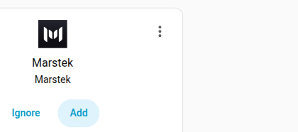
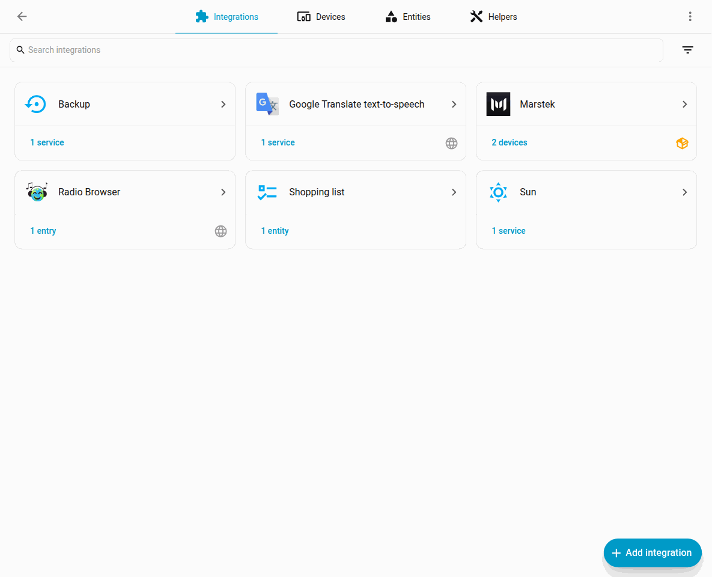

# Configuration

## Add the integration

1. Go to **Settings** > **Devices & services**.
2. Click **Add integration**.
3. Search for **Marstek**.
4. Select your device from the discovered list and complete setup.

If discovery doesn’t find your device (or all discovered devices are already configured), Home Assistant will guide you to **manual entry** where you can enter the device **IP address** (and optionally a **port**, default `30000`).

The Open API port is configurable per device in the Marstek app, and firmware answers only on the port it listens on. A broadcast scan therefore probes `30000`, the common custom ports `30001`–`30004` and `30030`, plus every port already stored on a config entry. A device on any other port needs manual entry.

### Discovery screen examples

## Device page

After setup you’ll see a device page with sensors/entities grouped under the device.

The [visual tour](screenshots.md) continues from here: the Battery health sidebar, the Lovelace cards, and linking a smart plug. Diagnostic sensors such as battery temperature start disabled; how to enable them is in that tour and in [Entities](entities.md).

## IP changes

If your device IP changes (DHCP), the background scanner updates the config entry to the address the device answered from. A `Marstek.GetDevice` payload can keep naming the previous address after a lease change; that value is not written over a host that is still answering. A DHCP lease from Home Assistant still updates the host.

Unique IDs are based on the device’s **BLE MAC** (falling back to other MACs when needed) so entities remain stable across IP changes.

## Firmware updates

The integration stores Open API `ver` on the config entry and uses it for the firmware profile, the device-registry **Firmware** field, and the reset-prone repair warning. After a device firmware update it refreshes that value on its own:

1. **Setup / reload** — a unicast `Marstek.GetDevice` to the stored IP (the same request Reconfigure uses). Broadcast discovery is not required, so a VLAN-isolated device still updates.
2. **Background scanner** — the 10-minute broadcast sweep still updates firmware when it hears the device. If that sweep sees nothing (no broadcast forwarding), the scanner falls back to the same unicast query.

When the new `ver` unlocks or removes setup-time capabilities (for example Venus A firmware `148` → `150` adding SYS controls and clearing the Open API reset warning), the config entry reloads automatically. Cosmetic metadata such as Wi-Fi name or a firmware number that does not change those capabilities is stored without a reload. You do not need to delete and re-add the device. **Reconfigure** also queries the device directly and is the manual path if you want to refresh firmware immediately.

## Unsupported devices

Venus **E 2.0** is not supported.
