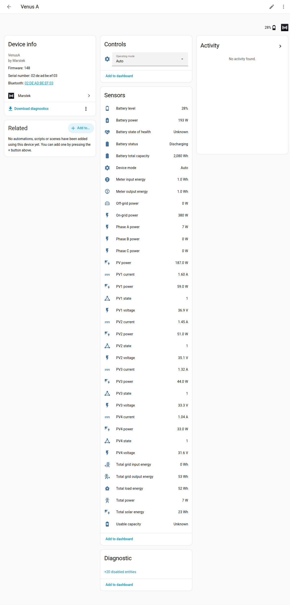

# Entities

This page lists every sensor and control the integration can create, with its name, unit and whether it starts on or off. Use it to find the right sensor for a dashboard card or an automation, or to check why a sensor is missing on your battery.

An entity is one sensor or control in Home Assistant, such as **Battery level** or **Operating mode**. Names below match the English names Home Assistant shows. The **Key** column is the internal name; you mostly need it when you read other pages or report a problem.

Not every battery gets every entity. Solar inputs, UPS mode and the depth of discharge, Bluetooth and LED controls are only created when your model and [firmware](guide/glossary.md#firmware) support them. A missing entity is left off the device page instead of showing as unavailable forever. If a firmware update adds or removes one of these features, the integration reloads the battery by itself and the list updates. See [Firmware updates](configuration.md#firmware-updates).

> [!NOTE]
> Some entities are **Diagnostic** and **disabled by default**. To turn one on, open it from the device page, select the gear icon, switch on **Enabled**, and select **Update**.

> [!WARNING] Battery detail sensors start disabled
> Reading battery details is suspected to make some Marstek firmware restart by itself ([issue #14](https://github.com/taurgis/has-marstek-local-api/issues/14)). The five entities that need that reading are therefore **disabled by default on new installations**: Battery temperature, Battery remaining capacity, Battery rated capacity, Charge permission and Discharge permission. The integration only asks the battery for these details while at least one of them is enabled. On firmware **150** or newer, enabling any of them starts those requests again.
>
> **Firmware that can reset the Open API (Venus A, D, E 3.0 or Venus E mini below 150, Venus C below 156, or an unknown firmware number):** those five entities are not created at all, even if you enabled them before, and the battery is never asked for these details. See [Repairs](repairs.md#firmware-can-reset-open-api). After a firmware update to 150 or newer, they come back (still disabled by default).
>
> **Upgrading an existing install on firmware 150 or newer?** Entities that were already registered stay enabled; upgrades never disable entities on firmware that can safely use them. To stop the battery detail requests, disable the five entities above once by hand (device page → entity → ⚙️ → *Enabled* off).

::: details Technical details
All entities are **coordinator-backed** (no per-entity polling): one shared update per battery feeds every entity.

Capability-gated entities (PV channels, UPS, SYS DOD/BLE/LED) are **created only when the firmware profile supports them**. After a firmware update that unlocks or removes those capabilities, setup, the scanner, or **Reconfigure** refreshes `ver` (unicast `Marstek.GetDevice` if broadcast cannot reach the device) and reloads the config entry so the entity set matches the new profile.

Meter input/output energy sensors are created when `EM.GetStatus` (or the Rev 3.1 `ES.GetMode` fallback) actually reports those fields. Firmware `ver >= 150` on a known family scales the wire unit 0.1 Wh → Wh; older profiles leave a present value unscaled.

The battery detail entities depend on the `Bat.GetStatus` call: Battery temperature (`bat_temp`), Battery remaining capacity (`bat_capacity`), Battery rated capacity (`bat_rated_capacity`), Charge permission (`bat_charg_flag`) and Discharge permission (`bat_dischrg_flag`). Enabling any of them resumes the call automatically on Control firmware **150+**. On reset-prone firmware, `Bat.GetStatus` is never sent, and after a firmware update to 150+ setup or the scanner reloads the config entry so the entities can be created again.
:::

## Sensors

These are the main readings. Power is in watts (W), energy in watt-hours (Wh). **Total power** and the **Phase A/B/C power** sensors come from the Marstek [CT meter](guide/glossary.md#ct-meter-ct002-ct003) at your fuse box, so they show your house's grid power, not the battery's. Despite their names, **Total grid input energy** and **Total grid output energy** count energy into and out of the battery itself; [Energy dashboard](energy_dashboard.md) explains where each one belongs.

| Entity name | Key | Unit | Category | Default |
|---|---|---|---|---|
| Battery level | `battery_soc` | % | — | Enabled |
| Battery power | `battery_power` | W | — | Enabled |
| On-grid power | `ongrid_power` | W | — | Enabled (if supported) |
| Off-grid power | `offgrid_power` | W | — | Enabled (if supported). Optional clamp to 0 W for negative readings: see [Options](options.md#power-settings). |
| PV power | `pv_power` | W | — | Enabled (if supported) |
| Device mode | `device_mode` | — | — | Enabled |
| Battery status | `battery_status` | — | — | Enabled |
| Total power | `em_total_power` | W | — | Enabled (not on Venus C below 155) |
| Phase A power | `em_a_power` | W | — | Enabled (not on Venus C below 155) |
| Phase B power | `em_b_power` | W | — | Enabled (not on Venus C below 155) |
| Phase C power | `em_c_power` | W | — | Enabled (not on Venus C below 155) |
| Meter input energy | `em_input_energy` | Wh | — | Enabled (if reported) |
| Meter output energy | `em_output_energy` | Wh | — | Enabled (if reported) |
| Total solar energy | `total_pv_energy` | Wh | — | Enabled (Venus A and D only) |
| Total grid output energy | `total_grid_output_energy` | Wh | — | Enabled |
| Total grid input energy | `total_grid_input_energy` | Wh | — | Enabled |
| Total load energy | `total_load_energy` | Wh | — | Enabled |
| Battery total capacity | `bat_cap` | Wh | — | Enabled (if reported; not created on Venus E mini, whose firmware reports remaining energy there) |
| Usable capacity | `battery_usable_capacity` | Wh | — | Enabled. Unknown until enough clean measurements exist; see [Usable capacity](usable-capacity.md). |
| Battery state of health | `battery_state_of_health` | % | — | Enabled (when the rated capacity is known) |

### Restarts

| Entity name | Key | Unit | Category | Default |
|---|---|---|---|---|
| Restarts | `device_restarts` | — | Diagnostic | Enabled |

Counts how often the battery restarted. A battery that restarts often may have a firmware or Wi-Fi problem. Short network dropouts and brief network resets are listed on the card but not counted as restarts. See [Restarts and dropouts](usable-capacity.md#restarts-and-dropouts)
for how the integration tells them apart.

::: details Technical details
The Open API has no uptime field, so a restart is
read from what a boot leaves in the polls the integration already makes; no
request is added. A restart is told apart from Wi-Fi that answers late, a network
dropout, or a brief network reset (listed, not counted). Attributes:
`restarts_30d`, `dropouts_30d`, `network_resets_30d`, `last_restart_at`,
`tracked_since` (when the log started), and `outages` (every outage of the last 30 days, for the card's Restarts tab;
kept out of the recorder).
:::

### PV channel sensors (PV1 to PV4)

These show each solar panel input separately. They are created on every Venus A and Venus D, for all four channels, even if a channel has no panel. Other models don't get them.
Power values are in watts.

::: details Technical details
Channel 1 is deciwatts (tenths of a watt) on observed firmware
(including 148.3, 149, and 150.9); the parser divides by 10, matching 1.0.0.
That PV1 scale is independent of the solar-energy ×10 used for [#35](https://github.com/taurgis/has-marstek-local-api/issues/35).
Do not skip the ÷10 ([#57](https://github.com/taurgis/has-marstek-local-api/issues/57)).
:::

| Entity name | Key | Unit | Category | Default |
|---|---|---|---|---|
| PV1 power | `pv1_power` | W | — | Enabled (if supported) |
| PV1 voltage | `pv1_voltage` | V | — | Enabled (if supported) |
| PV1 current | `pv1_current` | A | — | Enabled (if supported) |
| PV1 state | `pv1_state` | — | — | Enabled (if supported) |
| PV2 power | `pv2_power` | W | — | Enabled (if supported) |
| PV2 voltage | `pv2_voltage` | V | — | Enabled (if supported) |
| PV2 current | `pv2_current` | A | — | Enabled (if supported) |
| PV2 state | `pv2_state` | — | — | Enabled (if supported) |
| PV3 power | `pv3_power` | W | — | Enabled (if supported) |
| PV3 voltage | `pv3_voltage` | V | — | Enabled (if supported) |
| PV3 current | `pv3_current` | A | — | Enabled (if supported) |
| PV3 state | `pv3_state` | — | — | Enabled (if supported) |
| PV4 power | `pv4_power` | W | — | Enabled (if supported) |
| PV4 voltage | `pv4_voltage` | V | — | Enabled (if supported) |
| PV4 current | `pv4_current` | A | — | Enabled (if supported) |
| PV4 state | `pv4_state` | — | — | Enabled (if supported) |

### Diagnostic sensors (disabled by default)

These help when you troubleshoot: Wi-Fi signal and network details, battery temperature and capacity, and how often the battery answers the integration's requests (**API success rate**). They start disabled. Enable the ones you need as described at the top of this page. The battery temperature and capacity sensors have extra conditions; see the warning at the top.

| Entity name | Key | Unit | Category | Default |
|---|---|---|---|---|
| WiFi signal strength | `wifi_rssi` | dBm | Diagnostic | Disabled |
| Wi‑Fi IP address | `wifi_sta_ip` | — | Diagnostic | Disabled |
| Wi‑Fi gateway | `wifi_sta_gate` | — | Diagnostic | Disabled |
| Wi‑Fi subnet mask | `wifi_sta_mask` | — | Diagnostic | Disabled |
| Wi‑Fi DNS | `wifi_sta_dns` | — | Diagnostic | Disabled |
| Battery temperature | `bat_temp` | °C | Diagnostic | Disabled |
| Battery remaining capacity | `bat_capacity` | Wh | Diagnostic | Disabled |
| Battery rated capacity | `bat_rated_capacity` | Wh | Diagnostic | Disabled |
| Device IP | `device_ip` | — | Diagnostic | Disabled |
| Device version | `device_version` | — | Diagnostic | Disabled |
| Wi‑Fi name | `wifi_name` | — | Diagnostic | Disabled |
| BLE MAC | `ble_mac` | — | Diagnostic | Disabled |
| Wi‑Fi MAC | `wifi_mac` | — | Diagnostic | Disabled |
| MAC address | `mac` | — | Diagnostic | Disabled |
| API success rate (overall, and one per request type: ES.GetMode, ES.GetStatus, EM.GetStatus, PV.GetStatus, Wifi.GetStatus, Bat.GetStatus, ES.SetMode) | `api_success_rate_*` | % | Diagnostic | Disabled |

## Binary sensors (diagnostic, disabled by default)

A binary sensor is on or off. **CT connection** shows whether the battery is connected to its CT meter. **Charge permission** and **Discharge permission** show whether the battery currently reports that it is allowed to charge or discharge; they belong to the battery detail group in the warning at the top of this page.

| Entity name | Key | Device class | Default |
|---|---|---|---|
| CT connection | `ct_connection` | connectivity | Disabled |
| Charge permission | `bat_charg_flag` | — | Disabled |
| Discharge permission | `bat_dischrg_flag` | — | Disabled |

## Select

**Operating mode** shows the battery's current mode and lets you change it from a dashboard or automation. The [glossary](guide/glossary.md#auto-mode-self-consumption) explains each mode.

| Entity name | Key | Options |
|---|---|---|
| Operating mode | `operating_mode` | Auto, AI, Manual, Passive. **UPS** is added only when your model and firmware support it (see below). |

| Availability | UPS on the select |
|---|---|
| Venus A, D, E 3.0 and Venus E mini with firmware 150 or newer | Yes |
| Venus C (HMG-50), any firmware | No |
| Venus E mini with a known firmware number below 150 | No (the depth of discharge, Bluetooth and LED controls still appear; UPS does not) |
| Unknown firmware number | No |

> You can pick Auto, AI, and UPS (when listed) directly. Manual and Passive need extra settings, such as a power and a time, so you set them with an action instead (see [Automations and services](services.md)). Venus E mini firmware 301 has no Passive mode, so it is left out of the select and the `Set passive mode` action refuses it. `Set.Ver` and factory reset are not operating modes and are not offered here.

## Number (configuration)

**Depth of discharge** sets how far the battery may discharge before it stops ([DoD](guide/glossary.md#depth-of-discharge-dod)). A lower value keeps more charge in reserve.

This control, and the two switches below, only appear on supported firmware. Venus A, D and E 3.0 need firmware 150 or newer. Venus C (HMG-50) never gets them. Venus E mini needs a known firmware number (no 150 minimum). If the firmware number is unknown, these controls are left out.

| Entity name | Key | Unit | Range | Category | Default |
|---|---|---|---|---|---|
| Depth of discharge | `depth_of_discharge` | % | 30–88, step 1 | Config | Enabled (if supported). Starts at 88 when nothing valid was restored. |

The battery can't report its current depth of discharge back to Home Assistant. Home Assistant shows the last value it successfully set. If you change it in the Marstek app or with another tool, Home Assistant does not see that change.

## Switch (configuration)

Same firmware and model availability as depth of discharge. Like depth of discharge, the battery can't report these settings back, so Home Assistant shows the last value it successfully set. Until you set a switch once, it shows `unknown`.

| Entity name | Key | Category | Notes |
|---|---|---|---|
| Bluetooth advertising | `bluetooth_advertising` | Config | On enables advertising; off disables it. |
| Panel LED | `panel_led` | Config | On turns the panel LED on; off turns it off. |

The integration deliberately offers no control for a factory reset or for changing the firmware version (`Reset.Factory` and `Set.Ver` in the Open API).

## Device grouping

Each battery's entities are grouped under one device. They keep their identity when the battery gets a new IP address, so history and automations keep working.

**Meter input energy** and **Meter output energy** are only created when your battery reports them. You can use them on the [Energy dashboard](energy_dashboard.md).

::: details Technical details
Meter input/output energy sensors are created only when `EM.GetStatus` (or Rev 3.1 `ES.GetMode` fallback) reports those lifetime totals. They use the same BLE-MAC unique ID pattern as other sensors and are suitable for the Energy Dashboard (`device_class: energy`, `state_class: total_increasing`, native unit `Wh`).
:::

