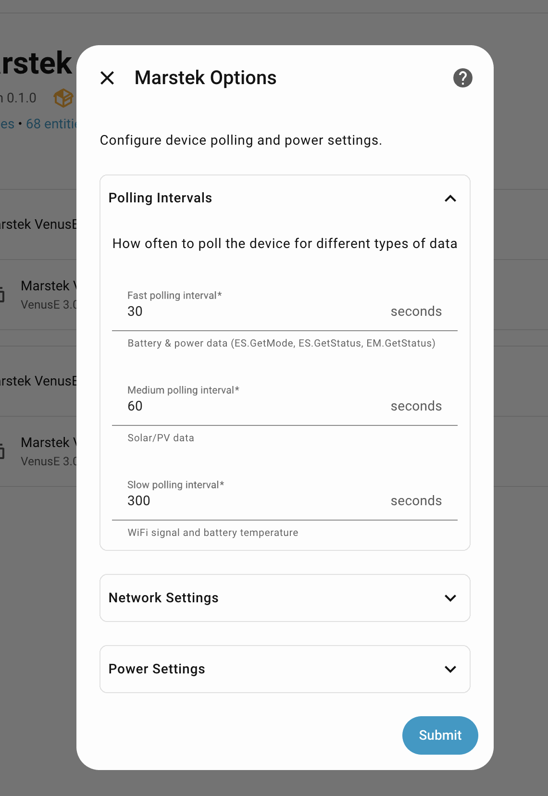
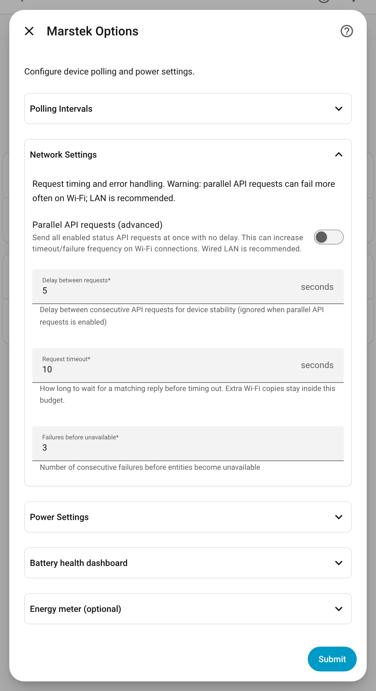
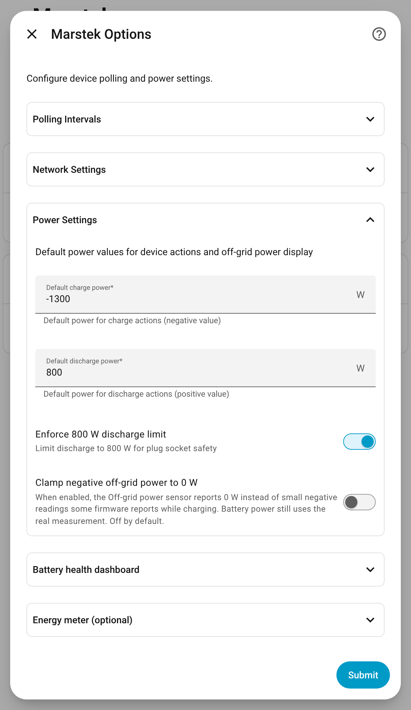
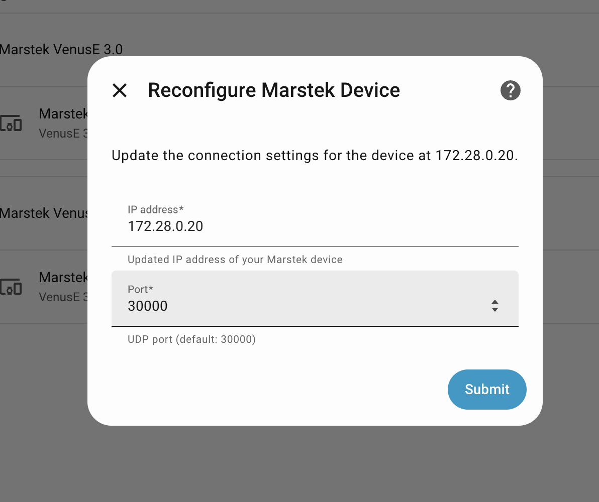

# Options

Open **Settings** > **Devices & services** > **Marstek** > your battery > **Configure**.

## Polling Intervals

The integration uses tiered polling to reduce device load:

- **Fast** (default 30s, range 10–300s): mode/status/meter (real-time power)
- **Medium** (default 60s, range 30s–24h): PV status (Venus A/D)
- **Slow** (default 300s, range 60s–24h): WiFi + battery diagnostics

## Network Settings

Options also expose request timing knobs to avoid UDP bursts:

- **Parallel API requests** (advanced, default off)
- **Delay between requests** (default 5 s, range 1–30 s)
- **Request timeout** (default 10 s, range 5–60 s)
- **Failures before unavailable** (default 3, range 1–10)

### Parallel API requests (advanced)

When enabled, the integration sends enabled status requests in parallel with no
inter-request delay.

- Improves update speed on some stable networks.
- Can increase API timeouts/failures, especially on Wi-Fi.
- Wired LAN is recommended if this mode is enabled. Firmware 150 fixed Local
  API **Ethernet** sends; Wi-Fi still goes through the FC41D module and can
  time out more often (limited local testing).
- Ignored on Venus C and other HMG-50 firmware (the Open API shares a Wi-Fi
  channel with the battery's meter link there), and on firmware the
  integration treats as reset-prone (Venus A, D and E 3.0 below 150, including
  Open API `ver` 1476 / app 147.6; Venus E mini below 150; HMG-50 below 156;
  a missing or unknown `ver`). Venus E
  3.0 **150** is the vendor Local API Ethernet fix. Reset-prone devices also
  serialize unicast requests and skip `Bat.GetStatus`.

### Repeated requests

This happens whether parallel requests are on or off. On firmware the
integration does not treat as reset-prone (and not on Venus C), a read request
that gets no reply is sent again at 0.5 s, 2.5 s and 5 s, as long as that stays
within the **Request timeout**. A reply stops the copies, so a battery that
answers within 0.5 s never gets one.

The **Delay between requests** field remains configurable, but it is ignored while
parallel API requests is enabled.

The failures threshold controls when entities are marked unavailable. Until the
threshold is reached, the integration keeps the last known values to avoid
flapping on an unstable device API.

*Older screenshot: it predates the Parallel API requests toggle and the 5 s default delay.*

## Power Settings

These settings affect automations, command validation, and how off-grid power is shown:

- **Default charge power** (W, range -5000–0, default -1300): default power for the **Charge** device action
- **Default discharge power** (W, range 0–5000, default 800): default power for the **Discharge** device action
- **Enforce 800 W discharge limit**: caps the discharge power that services and actions may request, for batteries plugged into a wall socket
- **Clamp negative off-grid power to 0 W** (default **off**): the Off-grid power sensor reports 0 W instead of small negative readings some firmware reports while charging with nothing on the EPS socket. Derived battery power still uses the signed value from the parser.

The 800 W limit defaults to **on** for Venus C, Venus D, Venus E and Venus E mini, and **off** for Venus A. While it is on, a discharge request above **800 W** is refused. With it off, the cap is the per-family maximum:

| Family | Maximum absolute power |
|---|---|
| Venus A | 1500 W |
| Venus D | 2200 W |
| Venus C, Venus E, Venus E mini | 2500 W |
| Unknown family | 5000 W |

Charging is always validated against the same per-family maximum (as a negative value); the socket limit only caps discharge.

*Older screenshot: the limit is now labelled **Enforce 800 W discharge limit**, and the Clamp negative off-grid power toggle is new.*

## Battery health dashboard

**Show Battery health in the sidebar** adds a **Battery health** page (Dutch: **Batterijgezondheid**) that compares every Marstek battery. The cards are available from **Add card** whether this is on or off. The option starts off. Turning it off again hides the sidebar entry and leaves the dashboard in place. Reload the browser if the sidebar entry does not appear after you submit.

What the page shows, and how to add the same cards to a dashboard you already have, is the [visual tour](screenshots.md#battery-health-sidebar-dashboard).

## Energy meter (optional)

Link a smart plug or meter that sits only between this battery and the mains
(a HomeWizard Energy Socket, a Shelly plug, or any meter with total energy
sensors). The plug then measures the round trip and the standby draw, and the
cards show the plug's live power. Leave both fields empty to use only the
battery's own readings.

- **Energy into the battery**: a total energy sensor that counts what the plug delivers to the battery. On a HomeWizard socket, **Energy import**.
- **Energy out of the battery**: a total energy sensor that counts what the battery sends back. On a HomeWizard socket, **Energy export**. Home Assistant creates that sensor disabled until you enable it on the socket's device page.

Fill both or neither, and pick two different sensors. The screenshot uses a lab meter named Mock energy plug. On your system the entities are named after your plug.

How to link the plug, step by step, is [Link a smart plug](usable-capacity.md#link-a-smart-plug). How the numbers are calculated is [Energy meter (optional)](usable-capacity.md#energy-meter-optional) in the under-the-hood half of that page.

## Reconfigure

To change a battery's IP address or port, open **Settings** > **Devices & services** > **Marstek**, select the three-dot menu next to the battery, and choose **Reconfigure**.

