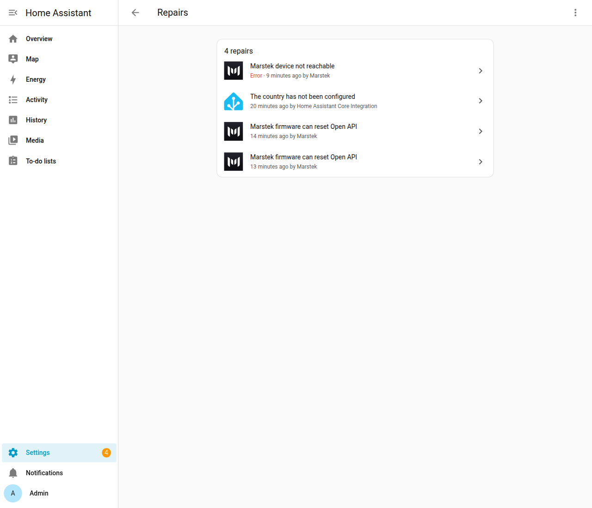
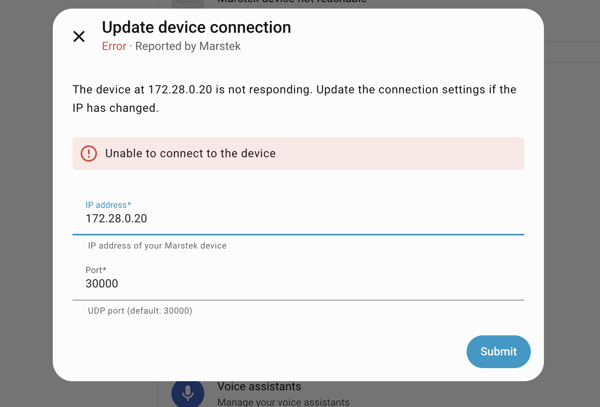
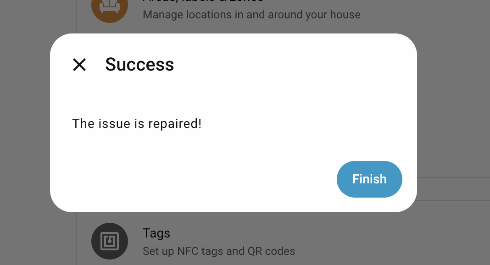

# Repairs

Home Assistant shows a repair when the integration finds a problem you can fix, or a firmware issue you should know about. This page explains each Marstek repair and what to do about it.

You find repairs under **Settings** > **System** > **Repairs** (see [Repairs](guide/glossary.md#repairs) in the glossary). Screenshots of the connection repair are in the [visual tour](screenshots.md#energy-dashboard-and-repairs).

## Cannot connect

Shown as **Marstek device not reachable**. Home Assistant can't reach the battery at its stored address, for example because your router gave it a new IP address. Open the repair to:

- Enter an updated **IP address** and **Port**
- Let the integration check that the battery at that address is the same one (it compares the battery's hardware ID)
- Apply the fix; the integration then reloads the battery by itself

If the battery at the new address is a different one, the repair refuses the change. This stops you from pointing the entry at the wrong battery by mistake.

## Firmware can reset Open API

Shown as **Marstek firmware can reset Open API**. On some older firmware, the integration's regular requests can switch off the battery's Open API and wipe its settings ([#15](https://github.com/taurgis/has-marstek-local-api/issues/15)). The warning appears for:

- Venus A, D, E 3.0 and Venus E mini with firmware below **150**
- Venus C and Venus E 2.0 (HMG-50) with firmware below **156**
- any battery whose firmware number is missing or unknown

After a firmware update to 150 or newer (156 or newer on Venus C and Venus E 2.0), the warning no longer applies. See [Troubleshooting](troubleshooting.md).

The warning is based on the firmware number the integration stored earlier, so it also appears while setup is still retrying and before the battery has answered.

## Open API can interrupt the device's own meter

Shown as **Marstek Open API can interrupt this device's own meter**. On Venus C, the integration's requests and the battery's own meter readings share one Wi-Fi channel. Each request can make the battery miss meter readings, and Self-consumption (Auto) mode needs those readings to decide when to charge ([#82](https://github.com/taurgis/has-marstek-local-api/issues/82)).

The warning appears for every Venus C and Venus E 2.0, including firmware **156** and **158**. You can't fix it from Home Assistant. See
[Troubleshooting](troubleshooting.md#venus-c-stops-charging-from-excess-solar-in-auto-mode) for what you can do.

Technical details

HMG-50 Control (Venus C and Venus E 2.0) shares one Wi-Fi receive channel
between the Local API server and the device's own UDP meter client, so
polling can cost it the meter samples that Self-consumption (Auto) mode
regulates on. The warning is created from stored firmware metadata for every
HMG-50 entry, including firmware **156** and **158**.

## Venus E 2.0 support is experimental

Shown as **Venus E 2.0 support is experimental**. Venus E 2.0 can be added, and this warning says that support is community-tested. Depth of discharge, Panel LED, and Bluetooth advertising are named as they appear on the device page, and they start at firmware 158. UPS is not offered. You can ignore the warning. Ignore stays in place across a reload and a restart. It is removed when you delete the battery, or when that battery no longer reports as Venus E 2.0. See [Troubleshooting](troubleshooting.md#venus-e-20).

## Other cases

The four repairs above are the ones the integration creates today: the connection repair, the reset-prone firmware warning, the HMG-50 meter warning, and the Venus E 2.0 experimental-support warning.

