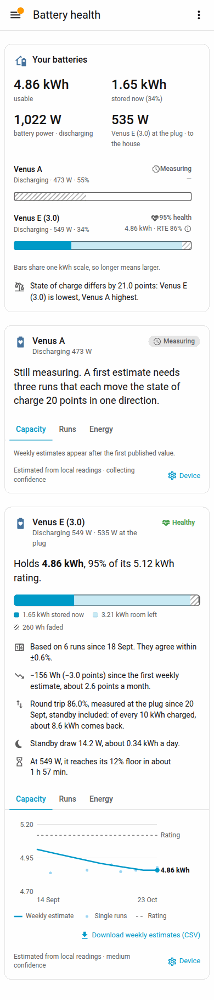
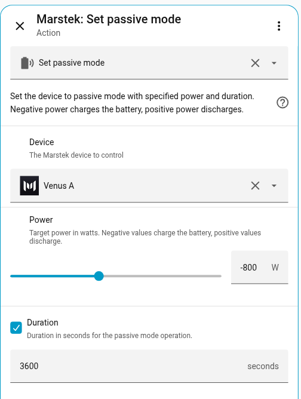
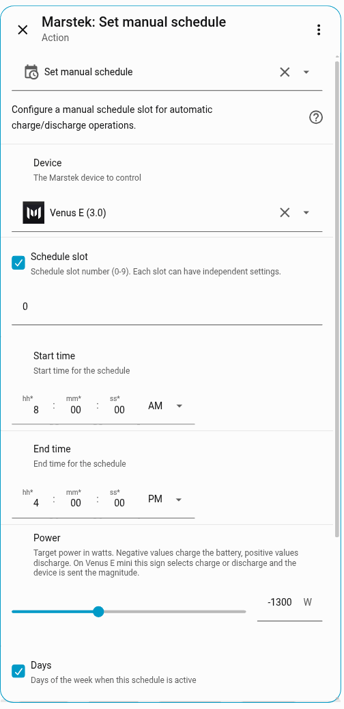
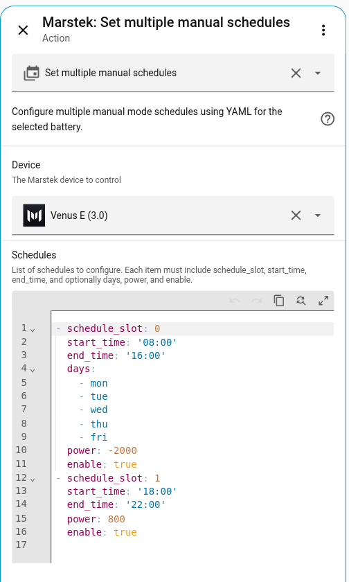
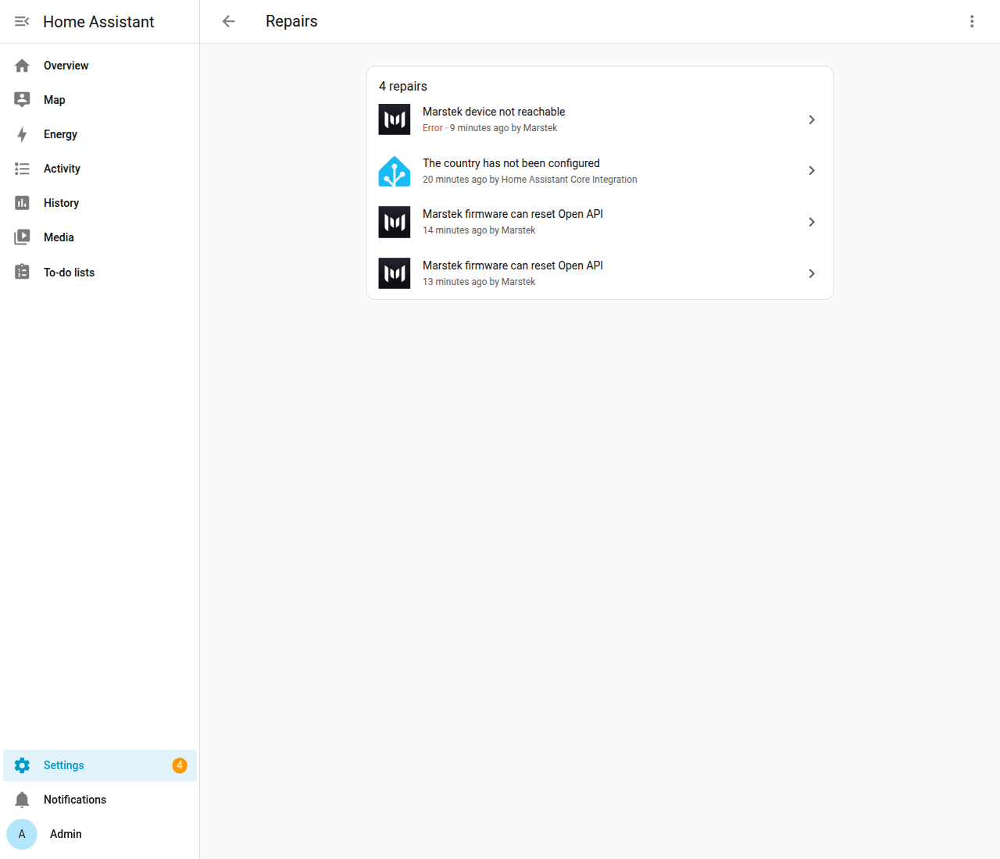
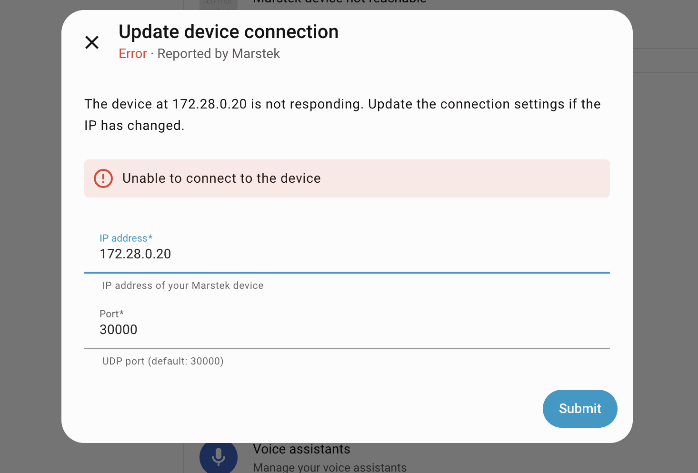
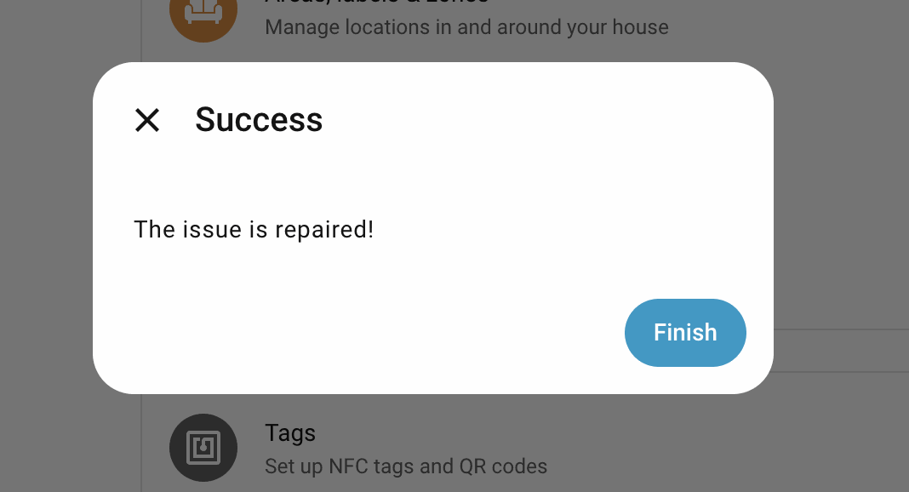

# Visual tour

This page walks through the integration the way you meet it in Home Assistant: finding the battery, reading battery health, adding the cards, linking a smart plug, driving charge and discharge, and hooking the Energy dashboard. Each step has a screenshot.

The pictures use two lab batteries, **Venus E (3.0)** and **Venus A**, plus a stand-in energy meter. Your device names and numbers will differ. Venus E in these shots already has a capacity estimate. Venus A is still collecting its first runs, so you can see both states.

A shorter path, with the same pictures, is the [README](../README.md). The calculation behind the estimate is [Battery health](usable-capacity.md#how-it-works-under-the-hood).

## 1. Discovery and setup

Turn on **Open API** in the Marstek app first, and keep Home Assistant on the same network as the battery. Then:

1. Go to **Settings → Devices & services**.
2. Choose **Add integration** and search for **Marstek**.
3. Pick the battery from the discovered list.

When discovery finds nothing, or every discovered battery is already added, Home Assistant asks for the **IP address** and the **port**. The port in the Marstek app is **30000** unless you changed it. The full steps, including what happens when the IP changes later, are in [Configuration](configuration.md).

After setup, the device page groups the sensors, the operating-mode select, and the controls.

A few diagnostic sensors, including **Battery temperature**, start disabled. `Bat.GetStatus`, the request behind them, has been suspected of resetting some batteries, so the integration waits until you opt in. On the device page, show disabled entities, open **Battery temperature** (or another battery-detail entity), open the gear, and turn **Enabled** on. On recent firmware the request starts on its own. On older firmware those entities stay omitted. The full list is in [Entities](entities.md).

## 2. Battery health sidebar dashboard

The sidebar dashboard compares every Marstek battery. It is off until you turn it on.

1. Go to **Settings → Devices & services → Marstek**.
2. Open a device and choose **Configure**.
3. Open **Battery health dashboard**.
4. Turn on **Show Battery health in the sidebar** and submit.

The helper text on that toggle is the whole contract: the page compares every Marstek battery, it starts off, and turning it off again hides the sidebar entry and keeps the dashboard. Reload the browser if **Battery health** does not appear. In Dutch the title is **Batterijgezondheid**.

**Your batteries** is the fleet card:

- **usable** is the sum of the estimates.
- **stored now** is the energy in the packs, with the fleet state of charge.
- **battery power** is the combined charge or discharge power.
- **at the plug** appears once a smart plug is linked, and the label names which battery's plug it is.

The bars share one kWh scale, so a longer bar is a larger battery. A line under the bars calls out a wide gap in state of charge.

Each battery card has a band: **Healthy** (90% or more), **Fading** (80% up to 90%), **Worn** (below 80%), or **Measuring**. Venus E on the screenshot holds **4.86 kWh**, **95%** of its **5.12 kWh** rating, with the weekly chart on the **Capacity** tab. What each insight sentence means is on the [Battery health](usable-capacity.md#what-the-dashboard-shows) page.

On a phone the same page stacks the totals in two columns and stacks the cards.

## 3. Battery health cards on any dashboard

The same two cards can go on a dashboard you already have. This integration registers the card module, so after you install or upgrade you reload the browser and the cards are in the picker. There is no separate Lovelace resource to add.

1. Open the dashboard and choose **Edit dashboard**, then **Add card**.
2. Open **By card**.
3. Type `Marstek` in **Search cards**, or scroll down to **Custom cards**.
4. Choose **Marstek battery health** (`custom:marstek-battery-health-card`) for one battery, or **Marstek battery fleet** (`custom:marstek-battery-fleet-card`) for the comparison.

The visual editor asks for the battery, an optional title, whether the detail tabs show, and which tab opens first.

The picker keeps the English card names in every language. The words on the card follow your Home Assistant language (English and Dutch).

### Capacity, Runs, and Energy

**Capacity** is the weekly chart: the estimate as a line, each run as a dot, and the rating as a dashed line. **Download weekly estimates (CSV)** saves the weeks. The chart stays empty until the first estimate is published, which is what Venus A shows.

**Runs** lists every 20-point charge or discharge, newest first, eight to a page, with **All**, **Charge**, and **Discharge** filters. Each row compares that run with the median for its direction. **Download runs (CSV)** saves every kept run.

**Energy** shows lifetime **Charged from AC** and **Delivered to AC**. **Solar** appears on PV models such as Venus A. **Backup socket** appears once the off-grid output has delivered energy. The last line is equivalent full cycles, or "less than one full cycle" until a nameplate of energy has been delivered.

### Why the card says Still measuring

A first estimate needs three runs in one direction. Each run has to move the state of charge by 20 points, all charging or all discharging. The card shows progress on the open run, for example "3 of 20 points so far." The plain-language version is [Why does my card say Still measuring?](usable-capacity.md#why-does-my-card-say-still-measuring).

## 4. Link a smart plug

A plug between the battery and the mains measures the round trip the battery's own sensors cannot, because those sensors miss the power the battery uses to stay awake. Use a HomeWizard Energy Socket, a Shelly plug, or any meter with two total-energy sensors. The plug has to see only this battery, not the whole house.

1. On the plug's device page, enable the export sensor. On HomeWizard it is named **Energy export**, and Home Assistant leaves it disabled until you enable it. **Energy import** is energy into the battery.
2. Open **Settings → Devices & services → Marstek → (device) → Configure**.
3. Open **Energy meter (optional)**.
4. Set **Energy into the battery** and **Energy out of the battery**. Fill both, or leave both empty, and pick two different sensors.
5. Submit.

The lab meter in the screenshot is named Mock energy plug. On a HomeWizard socket the two sensors are **Energy import** and **Energy export**.

After the next matching state of charge, the cards can show:

- Live plug watts, in the card header and as **at the plug** on **Your batteries**.
- Round-trip efficiency measured at the plug, standby included, written as what comes back from every 10 kWh charged.
- Standby draw in watts and in kWh a day.

Details and the rules (both sensors, or neither) are in [Options](options.md#energy-meter-optional) and [Link a smart plug](usable-capacity.md#link-a-smart-plug).

## 5. Controlling the battery

**Auto**, **AI**, and, on firmware that allows it, **UPS** are on the operating-mode select on the device page. **Manual** and **Passive** need a power, a duration, or time slots, so they are services rather than a dropdown choice.

In an automation, choose the action type **Device**, pick the battery, and use **Charge battery**, **Discharge battery**, or **Stop charging/discharging**. Empty power fields use the defaults from [Options](options.md#power-settings).

`marstek.set_passive_mode` holds a watt setpoint for a number of seconds. Negative power charges, positive power discharges.

`marstek.set_manual_schedule` fills one time slot. `marstek.set_manual_schedules` fills several from a YAML list. `marstek.clear_manual_schedules` clears them.

Ready-to-copy YAML is in [Automations and services](services.md).

## 6. Energy dashboard and Repairs

Home Assistant's Energy dashboard wants lifetime energy sensors with an energy device class. For a Marstek battery:

1. Open **Settings → Dashboards → Energy**.
2. Add **Total solar energy** as solar production on Venus A or Venus D.
3. Add **Total grid input energy** as grid consumption and **Total grid output energy** as return to the grid.
4. Leave **Total load energy** off that dashboard. Its meaning depends on the device, so the integration does not recommend it as home consumption.

The entity names, units, and the cases where firmware counters stall are in [Energy dashboard](energy_dashboard.md). Official setup of the dashboard itself is [Home Assistant Energy](https://www.home-assistant.io/docs/energy/).

When Home Assistant loses the battery, **Settings → System → Repairs** offers a fix flow. You enter the new host and port, and the integration checks that the device is still the same one before it reloads.

Firmware warnings, including Venus C sharing a Wi-Fi channel with its meter, are described in [Repairs](repairs.md) and [Troubleshooting](troubleshooting.md).
