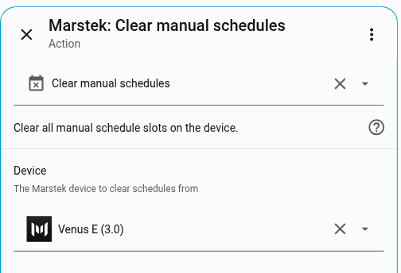

# Automations and services

This page shows how to make the battery charge, discharge or stop from a Home Assistant automation, and how to set Manual and Passive mode. Start with the device actions below: you pick them in the visual automation editor and need no YAML. Use the services further down when you need a timed charge, a weekly schedule, or more control.

> [!TIP]
> To control the battery from an automation, use the device actions or the services on this page rather than trying to change an entity's state directly.

## Device actions

A [device action](guide/glossary.md#device-action) is a ready-made step in the automation editor. To add one:

1. Open **Settings** > **Automations & scenes** and create or edit an automation.
2. Under **Then do**, select **Add action** and choose **Device**.
3. Choose your Marstek battery.
4. Pick **Charge battery**, **Discharge battery** or **Stop charging/discharging**, and enter a power if you want one.


### Charge battery

Starts charging the battery at the power you enter.

| Parameter | Required | Description |
|-----------|----------|-------------|
| Power (W) | No | Charge power in watts (0–5000). Enter a positive number. If you leave it empty, the action uses the **Default charge power** from [Options](options.md#power-settings). |

### Discharge battery

Starts discharging the battery at the power you enter.

| Parameter | Required | Description |
|-----------|----------|-------------|
| Power (W) | No | Discharge power in watts (0–5000). If you leave it empty, the action uses the **Default discharge power** from [Options](options.md#power-settings). |

### Stop charging/discharging

Stops the battery charging or discharging. It needs no settings.

### Power validation

All device actions respect the **Enforce 800 W discharge limit** option configured in [Options](options.md). If it is on (the default for Venus C, Venus D, Venus E and Venus E mini), discharge power above 800 W is rejected. With it disabled, the cap is the per-family maximum listed in [Options](options.md#power-settings).

### What the actions change on the battery

The actions work by putting the battery in **Manual mode** with one time slot that covers the whole day. Two things follow from that:

- The battery stays in Manual mode after the action, including after **Stop charging/discharging**. To let the battery regulate itself again, set **Operating mode** back to **Auto** (or AI).
- The actions use schedule slot `0`. If you stored your own Manual schedule in slot `0`, an action replaces it.

An action can take a minute or longer to finish. The integration checks that the battery accepted the change and tries again if it did not.

<details class="details custom-block">
<summary>Technical details</summary>

- Actions use **Manual mode** internally with a 24-hour schedule (00:00–23:59, all days)
- Each action is tried up to 8 times. After each try, the integration waits about one poll cycle to check that the battery took the change, and about one more before it tries again
- Verification confirms the device responded correctly before completing
- Polling is paused during command execution to avoid UDP traffic conflicts
- The command is `ES.SetMode` with `manual_cfg.time_num` 0

</details>

---

## How modes are set

The battery's [operating mode](guide/glossary.md#auto-mode-self-consumption) decides who is in control. Some modes need only a choice; others need a power and a time, so they are set with a service.

| Mode | How to set it |
|------|----------------|
| Auto, AI | **Operating mode** select on the device page, or in an automation |
| UPS | **Operating mode** select, only when your model and firmware support it (firmware 150 or newer on Venus A, D, E 3.0 and Venus E mini; never on [HMG-50](guide/glossary.md#hmg-50) firmware, which is every Venus C firmware seen so far) |
| Manual, Passive | The services below, because they need a power and a time (picking them in the select does not apply empty defaults) |

A factory reset and changing the firmware version (`Set.Ver`) are **not** services, entities, or recommended actions.

A Manual schedule is stored in numbered slots. How many slots you get depends on the model:

| Family | Valid `schedule_slot` |
|--------|----------------------|
| Venus A / C / D / E | `0–9` |
| Venus E mini | `0–5` (slot `6` and above is rejected) |

The service form accepts `0–9` for every model; the integration then checks the number against your battery and refuses slots it doesn't have.

## Use the services

The services do more than the device actions: Passive mode with a time limit, Manual schedules, and an instant data refresh. You can add them in the visual automation editor too. Select **Add action**, search for **Marstek**, and fill in the form. Only **Set multiple manual schedules** needs you to type a YAML list.

Every service needs to know which battery to control. Pick it in the **Device** field. The only exception is `marstek.request_data_sync`, where the device is optional and leaving it empty refreshes every battery.

<details class="details custom-block">
<summary>Writing services in YAML</summary>

Home Assistant device IDs are **32-character hex** strings. Quote them in YAML so they stay strings:

```yaml
action: marstek.set_passive_mode
data:
  device_id: "a1b2c3d4e5f6a1b2c3d4e5f6a1b2c3d4"
  power: -500
  duration: 300
```

If you are pasting YAML, prefer the device picker in Developer Tools, or pass the battery entity ID / MAC instead of copying a truncated ID from a template.

Services are registered when Home Assistant starts and remain available even if
no Marstek devices are currently loaded. If no matching device or config entry
is available, the service call will return an error.

</details>

## `marstek.set_passive_mode`

Shown in the editor as **Set passive mode**. The battery charges or discharges at the power you choose, for the time you choose ([Passive mode](guide/glossary.md#passive-mode)). Use it for a one-off boost, for example charging for an hour while electricity is cheap.

Power is in watts: a negative number charges, a positive number discharges. Duration is in seconds, so one hour is `3600`.

- `device_id` (required): target Marstek device
- `power` (required, W): negative = charge, positive = discharge
  - Input range is `-5000..5000`, but the effective limit is validated per device/model (and may depend on the **Enforce 800 W discharge limit** option).
- `duration` (optional, seconds): how long to keep passive mode active (default `3600`, range `0..86400`)

Not available on Venus E mini firmware 301. That firmware has no Passive mode, so the action fails with a "mode not supported" error and nothing is sent.


## `marstek.set_manual_schedule`

Shown in the editor as **Set manual schedule**. It sets one time slot of the battery's weekly [Manual mode](guide/glossary.md#manual-mode) timetable: a start and end time, a power, and the days it applies. Use it when one charge or discharge window is enough.

- `device_id` (required): target Marstek device
- `schedule_slot` (optional): slot index (default `0`; max `9` on Venus A/C/D/E, max `5` on Venus E mini)
- `start_time` (required): start time
- `end_time` (required): end time. It must be later than `start_time`; a slot can't run past midnight, so split an overnight window into two slots (for example 23:00–23:59 and 00:00–06:00).
- `power` (required, W): negative = charge, positive = discharge
  - Input range is `-5000..5000`, but the effective limit is validated per device/model (and may depend on the **Enforce 800 W discharge limit** option).
  - On **Venus E mini** you still enter a signed power; the integration converts it. Details for developers: the Open API also has `manual_cfg.manual_set` (Rev 3.1: 0 disable, 1 charge, 2 discharge, 3 auto). The service stays signed. The wire payload sends `abs(power)` and derives `manual_set` (`enable` off → 0, negative → 1, positive → 2). An enabled 0 W slot sends `1` (charge), not `3` (auto), until hardware confirms auto. Other families omit the field and keep signed `power`.
- `days` (optional): list of weekday values (default all days)
  - Valid values: `mon`, `tue`, `wed`, `thu`, `fri`, `sat`, `sun`
- `enable` (optional): enable/disable this slot (default `true`)


## `marstek.set_manual_schedules`

Shown in the editor as **Set multiple manual schedules**. It sets several time slots in one go. You type the slots as a YAML list in the **Schedules** field; the examples below can be copied and adjusted.

- `device_id` (required): target Marstek device
- `schedules` (required): YAML list of schedule objects
  - Required per item: `schedule_slot`, `start_time`, `end_time`
  - Optional per item: `days`, `power`, `enable`
  - `start_time`/`end_time` must be strings in `HH:MM` format

### Example YAML

> Replace `YOUR_DEVICE_ID` with the device ID from the device selector in the UI.

#### What to paste into the **`schedules`** input field

In the Home Assistant service UI, the `schedules` field expects **only the YAML list**. Example:

```yaml
- schedule_slot: 0
  start_time: "10:00"
  end_time: "15:30"
  days: [mon, tue, wed, thu, fri]
  power: -2000
  enable: true
- schedule_slot: 1
  start_time: "18:00"
  end_time: "22:30"
  days: [mon, tue, wed, thu, fri]
  power: 1200
  enable: true
```

#### 1) Weekday daytime charging (solar/top-up) + evening discharge (peak shaving)

```yaml
action: marstek.set_manual_schedules
data:
  device_id: YOUR_DEVICE_ID
  schedules:
    - schedule_slot: 0
      start_time: "10:00"
      end_time: "15:30"
      days: [mon, tue, wed, thu, fri]
      power: -2000
      enable: true
    - schedule_slot: 1
      start_time: "18:00"
      end_time: "22:30"
      days: [mon, tue, wed, thu, fri]
      power: 1200
      enable: true
```

#### 2) Charge at night on a cheap tariff

```yaml
action: marstek.set_manual_schedules
data:
  device_id: YOUR_DEVICE_ID
  schedules:
    - schedule_slot: 0
      start_time: "00:30"
      end_time: "05:30"
      days: [mon, tue, wed, thu, fri, sat, sun]
      power: -2500
      enable: true
```

#### 3) Weekend-only discharge (self-consumption boost)

```yaml
action: marstek.set_manual_schedules
data:
  device_id: YOUR_DEVICE_ID
  schedules:
    - schedule_slot: 2
      start_time: "09:00"
      end_time: "12:00"
      days: [sat, sun]
      power: 800
      enable: true
```

#### 4) Disable a slot without changing its stored times

```yaml
action: marstek.set_manual_schedules
data:
  device_id: YOUR_DEVICE_ID
  schedules:
    - schedule_slot: 1
      start_time: "18:00"
      end_time: "22:30"
      enable: false
```

#### 5) “Workday profile” with three time windows (morning charge, daytime idle, evening discharge)

```yaml
action: marstek.set_manual_schedules
data:
  device_id: YOUR_DEVICE_ID
  schedules:
    - schedule_slot: 0
      start_time: "06:00"
      end_time: "08:00"
      days: [mon, tue, wed, thu, fri]
      power: -1500
      enable: true
    - schedule_slot: 1
      start_time: "12:00"
      end_time: "13:00"
      days: [mon, tue, wed, thu, fri]
      power: 0
      enable: true
    - schedule_slot: 2
      start_time: "18:00"
      end_time: "23:00"
      days: [mon, tue, wed, thu, fri]
      power: 1000
      enable: true
```


## `marstek.clear_manual_schedules`

Shown in the editor as **Clear manual schedules**. It clears every Manual schedule slot on the battery, so you can start again from an empty timetable.

- `device_id` (required): target Marstek device

It clears every slot your model has (10 slots on Venus A/C/D/E, 6 on Venus E mini) one after the other, so it may take a short while.



## `marstek.request_data_sync`

Shown in the editor as **Request data sync**. It asks the battery for fresh values right away instead of waiting for the next regular update.

- `device_id` (optional): when omitted, all Marstek devices are refreshed

---

## Safety and responsiveness

- By default, the integration sends requests one at a time, because the batteries can stop answering when many arrive at once. While it sends a command, it pauses its regular updates.
- If **Parallel API requests** is enabled in [Options](options.md), status requests go out at the same time on purpose, which may be less stable on Wi-Fi.
- If your battery stops responding, increase **Delay between requests** or **Request timeout** in [Options](options.md#network-settings).
