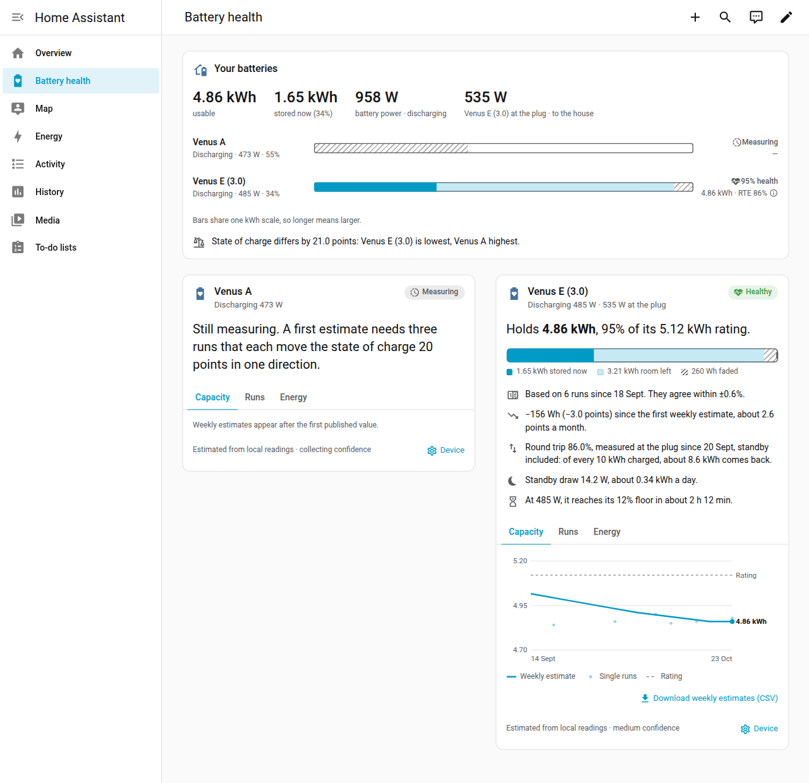
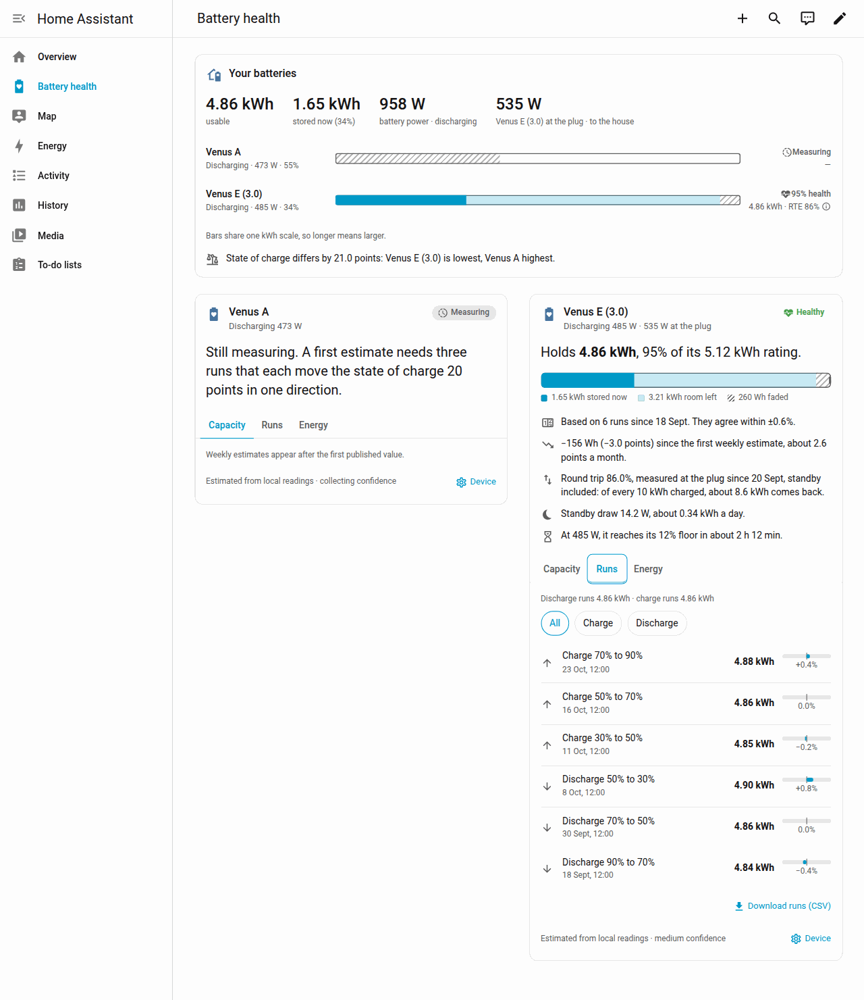
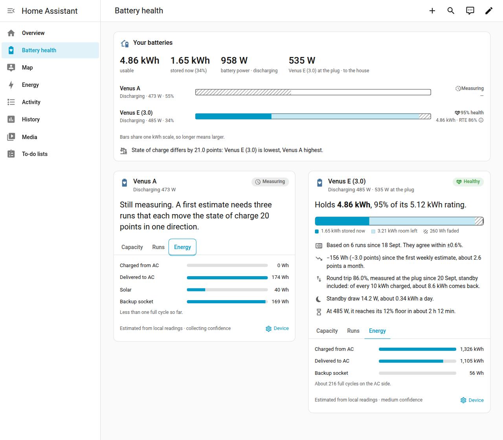
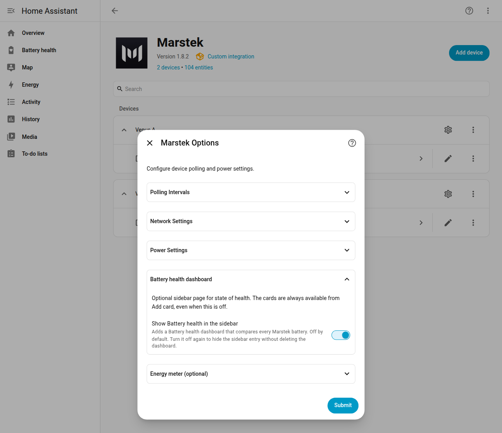
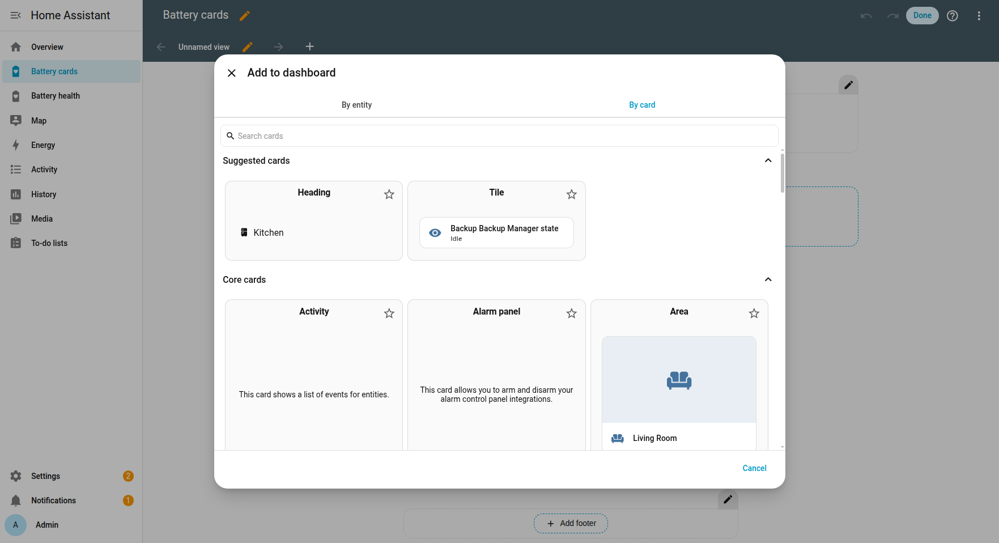
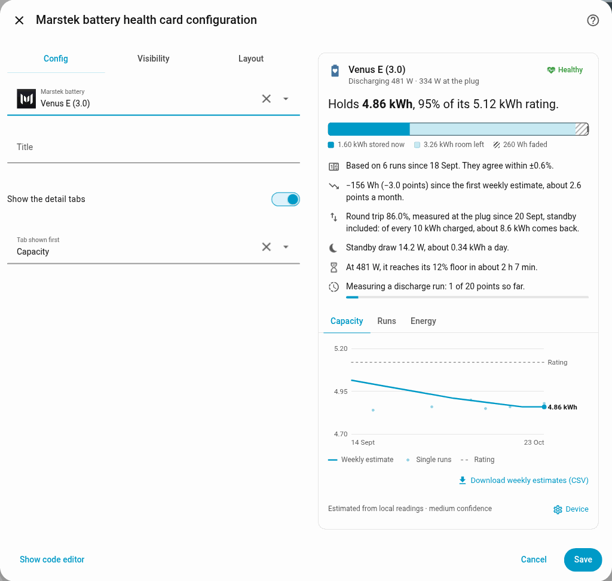
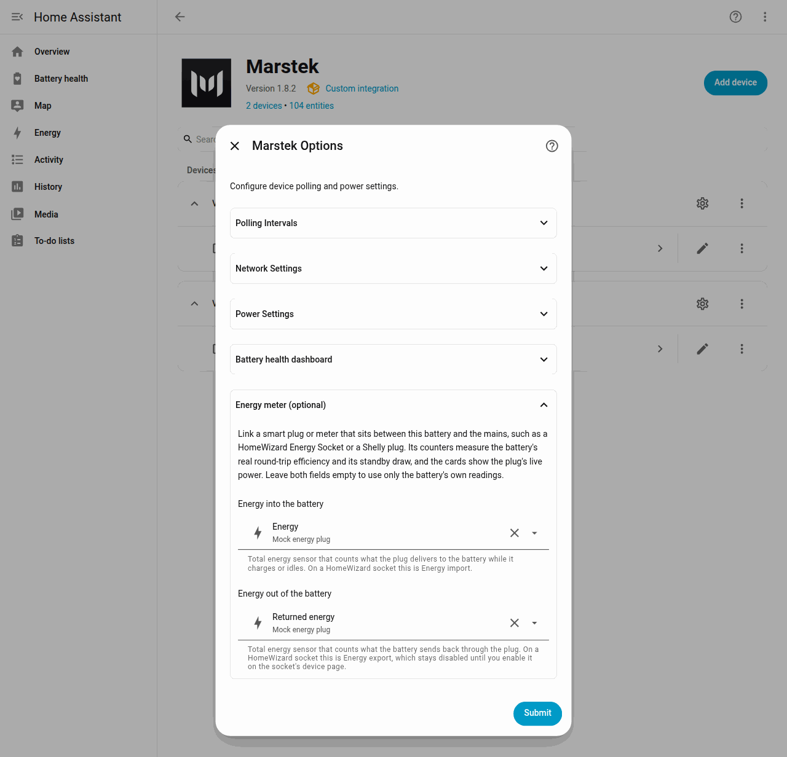

# Battery health

The integration estimates how much energy your battery can still store, and shows that estimate on an optional sidebar dashboard and on two Lovelace cards. The math uses readings Home Assistant already collects, so it adds no extra traffic to the battery and needs no cloud account.

**Usable capacity** is that estimate in watt-hours: the energy the pack can store across a full 0–100% of the reported state of charge. **Battery state of health** is the same estimate as a percentage of the capacity printed on the battery (the nameplate). Both stay unknown until the battery has finished a few long charge or discharge runs. Until then the card says **Still measuring**. [Why that happens](#why-does-my-card-say-still-measuring) is a few paragraphs below.

The screenshots on this page are from a Home Assistant setup with a Venus E (3.0) that already has an estimate and a Venus A that is still collecting runs. Your device names, wattages, and dates will differ. A phone-width view of the same dashboard is in the [visual tour](screenshots.md).

## What the dashboard shows



**Your batteries** adds up every Marstek battery on this Home Assistant:

- **usable** is the sum of the estimates.
- **stored now** is the energy in the packs right now, with the fleet state of charge in parentheses.
- **battery power** is the combined charge or discharge power.
- **at the plug** appears once a smart plug is linked. The label names the battery whose plug reported that power.

The bars share one kWh scale, so a longer bar is a larger battery. A line under the bars points out a wide state-of-charge gap, the battery that holds the biggest share, and a battery that has faded past the Healthy band.

Each battery card shows:

- The name, whether it is charging, discharging, or idle, and the live watts. With a plug linked, the plug's watts sit on the same line.
- A band on the right: **Healthy** (90% or more), **Fading** (80% up to 90%), **Worn** (below 80%), or **Measuring** while there is no estimate yet.
- One sentence that says what the pack holds against its rating. On the screenshot, Venus E holds **4.86 kWh**, **95%** of its **5.12 kWh** rating.
- A bar split into energy stored now, room left, and the part that has faded.
- Short insights: how many runs the number is based on and how closely they agree, how much the weekly estimate has moved, what the round trip means per 10 kWh charged, standby draw when a plug is linked, and how long the pack can keep going at the current power.

While the battery is discharging at 50 W or more, that time runs down to the floor set by **Depth of discharge**. An 88% depth of discharge stops the pack at 12%, and the sentence names that floor. The Open API cannot read the setting back, so the card uses the last value written from Home Assistant, which starts at 88%.

### Capacity

The **Capacity** tab is the weekly chart: a line for the weekly estimate, a dot for each run, and a dashed line for the rating. **Download weekly estimates (CSV)** saves `week_start`, `usable_wh`, and `rated_wh`. The chart appears after the first published estimate. Venus A, still measuring, shows that empty state on the screenshot.

### Runs



**Runs** lists every kept run, newest first, eight to a page. Filter with **All**, **Charge**, or **Discharge**. Each row is one stretch that moved the state of charge by about 20 points, with its capacity and how far it sits from the median for that direction. The line above the list gives the median of the discharge runs and the median of the charge runs. **Download runs (CSV)** saves every kept run, including ones hidden by the filter.

### Energy



**Energy** is lifetime energy the battery has already counted:

- **Charged from AC** and **Delivered to AC** are the grid-side totals.
- **Solar** appears on models that report PV energy, such as Venus A and Venus D.
- **Backup socket** appears once the off-grid output has delivered some energy. On the screenshot Venus E's backup socket has barely been used, next to a long AC history. Venus A shows both **Solar** and **Backup socket**.
- Full cycles are the energy delivered to AC divided by the nameplate. Below one nameplate of delivered energy, the card says less than one full cycle.

### Restarts

**Restarts** lists the device restarts, brief network resets and network
dropouts of the last 30 days, newest first, under a heading per day (*Today*,
*Yesterday*, then the date) that counts each kind for that day. A line above the list gives the
30-day totals, or the totals since tracking started while that is less than
30 days ago. Each row names its kind next to its icon, with its time, and a
second line says how long the battery was offline and what showed the
restart: energy totals restored, CT meter disconnected, mode changed, or the
start-up test at a linked plug. A restart that fell between two polls says
so instead of an offline time. A brief network reset row explains in one
sentence that the battery dropped off the network for a few seconds and ran
its start-up check without restarting. A dropout row says there was no sign
of a restart. Ten rows show at first; **Show more** adds ten at a time and moves
focus to the first new row. **Download restarts (CSV)** saves `at`, `kind`,
`offline_s`, `failed_polls`, and `evidence` (trace names separated by `;`).
How the kinds are told apart is in [Restarts and dropouts](#restarts-and-dropouts).
With no outage in 30 days the tab says so; with the **Restarts** sensor
disabled it says to enable it.

## Turn on the sidebar dashboard

The sidebar page is off until you enable it. The cards themselves stay available from **Add card** either way.

1. Go to **Settings → Devices & services → Marstek**.
2. Open the device and choose **Configure**.
3. Open **Battery health dashboard**.
4. Turn on **Show Battery health in the sidebar** and submit.



Home Assistant adds a **Battery health** entry to the sidebar (in Dutch, **Batterijgezondheid**). It places **Your batteries** across the top and one card per battery below it. Reload the browser if the sidebar entry does not show up after you submit. Turning the option off again hides the sidebar entry and leaves the dashboard in place.

## Add the cards to a dashboard you already have

This integration registers the card module itself, so the cards show up in the picker after a browser reload. You pick them like any other card.

1. Install or upgrade the integration, then reload the browser.
2. Open your dashboard, choose **Edit dashboard**, then **Add card**.
3. Open the **By card** tab.
4. Type `Marstek` in **Search cards**, or scroll down to **Custom cards**.
5. Pick **Marstek battery health** for one battery, or **Marstek battery fleet** for the comparison.



The visual editor sets the battery, an optional title, whether the detail tabs show, and which tab opens first.



The card types, if you are editing YAML, are `custom:marstek-battery-health-card` and `custom:marstek-battery-fleet-card`. The picker lists those English names in every language. The words on the card follow your Home Assistant language. English and Dutch are included.

Clicking a row on the fleet card opens that battery's more-info dialog. To be notified when a battery leaves the Healthy band, use a numeric state trigger on **Battery state of health**. The sensor changes only when the estimate changes:

```yaml
triggers:
  - trigger: numeric_state
    entity_id: sensor.venus_e_3_0_battery_state_of_health
    below: 90
actions:
  - action: notify.notify
    data:
      message: >-
        {{ state_attr(trigger.entity_id, 'friendly_name') }} is at
        {{ trigger.to_state.state }}% of its rating.
```

Use `below: 80` for the Worn band. The card rounds to a whole percent, so the automation can fire a few tenths before the card changes band.

## Link a smart plug

A plug or meter that sits only between this battery and the mains sees energy the battery's own readings miss, including the power it draws to stay awake. HomeWizard Energy Socket and Shelly plugs both work, and so does any meter with two total-energy sensors.

1. On the plug's device page, enable the sensor that counts energy leaving the battery. On a HomeWizard socket that sensor is **Energy export**, and Home Assistant creates it disabled until the socket has exported or you enable it yourself. **Energy import** is the energy going into the battery.
2. Go to **Settings → Devices & services → Marstek → (device) → Configure**.
3. Open **Energy meter (optional)**.
4. Set **Energy into the battery** and **Energy out of the battery**. Fill both, or leave both empty. They have to be two different sensors.
5. Submit.



The screenshot uses a lab meter named Mock energy plug. On a HomeWizard socket you pick **Energy import** and **Energy export**.

With a meter linked, the cards add:

- The plug's live watts, on the health card under the battery name and as **at the plug** on **Your batteries**. The plug updates on its own schedule, so its watts can differ from the battery's 30-second reading.
- Round-trip efficiency measured at the plug, standby included. The sentence says "measured at the plug" and spells out what comes back from every 10 kWh charged.
- Standby draw in watts and in kWh a day.

Leave both fields empty to keep using only the battery's own readings. The round trip then says it was estimated from those readings, and standby is omitted.

## Why does my card say Still measuring?

A first estimate needs **three runs in one direction**. A run is one stretch of charging, or one stretch of discharging, that moves the state of charge by 20 points without a long pause, a mode change, or the power dropping to a trickle.

A discharge from 70% to 50% is one run. Three discharges like that publish a number. So do three charges. Two charges and one discharge do not: the two directions are kept separate until each has three runs. After that, the published number blends both.

Until then the card stays on **Measuring** and, while a run is open, shows how far it has got, for example "3 of 20 points so far." A battery that only trickles, or that changes direction often, can take days. Weekly estimates appear after the first published value.

The bands describe fade only. The Open API reports no warranty terms.

## How it works under the hood

You can stop at the sections above if you only want to use the dashboard and the cards. The rest of this page is the calculation, the stored history, and the limits.

The **Usable capacity** sensor estimates how much energy the pack can store
per 100 points of reported state of charge, in watt-hours. It is not the
energy inside the SYS depth-of-discharge setting, and it is not the figure
[Marstek Capacity Monitor](https://github.com/satscan1/marstek-capacity-monitor)
publishes after scaling a full discharge to that band. **Battery state of
health** is the estimate divided by the nameplate (`ES.GetStatus` `bat_cap`),
in percent. Both stay `unknown` until there is enough evidence. Neither one
adds a UDP request.

`battery_power` is an AC-side wattage. On Venus E 3.0, Venus A, and Venus D
the Open API usually omits `bat_power`, and the entity is
`ongrid_power + offgrid_power - pv_power` (positive discharges). Do not feed
that entity to a tool that wants DC battery power. Marstek Capacity Monitor
refuses AC power for this reason; using this entity there counts inverter
losses as pack energy.

Home Assistant records them as long-term statistics because usable capacity
uses `device_class: energy_storage` and `state_class: measurement`. That
combination stores a mean, minimum, and maximum, not a sum. The unit is Wh,
which the entity settings can display as kWh. State of health is a percentage
with the same `measurement` statistics. `last_reset` is not set: Core rejects
it for any state class other than `total`.

Sources, Home Assistant Core 2026.9.3 (the devcontainer image):

- [`SensorDeviceClass.ENERGY_STORAGE`](https://github.com/home-assistant/core/blob/2026.9.3/homeassistant/components/sensor/const.py)
  is "stored energy" and explicitly includes "the capacity of a battery".
  Its only allowed state class is `measurement`, and its unit converter is the
  energy converter (`Wh`, `kWh`, and the other `UnitOfEnergy` members).
- [`DEFAULT_STATISTICS`](https://github.com/home-assistant/core/blob/2026.9.3/homeassistant/components/sensor/recorder.py)
  maps `measurement` to mean, min, and max.
- [`SensorStateClass.MEASUREMENT`](https://developers.home-assistant.io/docs/core/entity/sensor/#available-state-classes)
  is "a measurement in present time".
- Setting `last_reset` outside `state_class: total` raises
  (`sensor/__init__.py` in that same Core tag).
- Accepted windows are kept in a [`Store`](https://github.com/home-assistant/core/blob/2026.9.3/homeassistant/helpers/storage.py)
  keyed by config entry (`marstek.usable_capacity.<entry_id>`, version 1).

## What the device actually reports

| Signal | Where | Used? |
| --- | --- | --- |
| `bat_soc` | `ES.GetStatus`, fast poll | Yes. State of charge, usually a whole percent. |
| Battery power | `bat_power` when the firmware sends it, otherwise `pv_power - ongrid_power - offgrid_power` | Yes. This is the AC-side wattage the integration already publishes (positive = discharging). |
| Operating mode | `ES.GetMode` | Yes, only to discard a window that changes mode. |
| `bat_cap` | `ES.GetStatus` | Nameplate for state of health, on families where it is the pack size. Not used as the estimate. |
| `bat_capacity`, `rated_capacity`, temperature, charge flags | `Bat.GetStatus` | No. The call stays off unless a diagnostic entity is enabled, and on some firmwares it is suspected of resetting the device. Those watt-hours are the BMS's own remaining and rated figures, not a measured fade. |
| Lifetime grid, PV, and load energy | `ES.GetStatus` | No. They count the house and the inverter, not coulombs into the pack. |
| Cycle count, cell voltage, BMS state of health | — | Not in the Open API. Not invented. |

Venus E mini reports remaining energy in `bat_cap`, so the integration does not
treat it as a nameplate. Usable capacity is still estimated. State of health
is not created.

## Formula

A window is one direction (charge or discharge), one mode, and no long gap.
At the default 30 second poll the gap limit is 180 seconds. The options flow
allows a fast poll up to 300 seconds, and Home Assistant starts that wait
after the poll has finished, so a slow setting would step past 180 seconds
on every successful poll. The limit then becomes the configured interval
plus 150 seconds, which is how long one poll can spend on its own requests
(six serial reads at the maximum 30 second delay). A missed poll is another
full interval and still ends the window. Raising the constant to 300 seconds
instead would let a 30 second poll stitch across a five-minute hole.
Power below 150 W ends the window. The window starts on the first poll
after the reported state of charge changes, not on whatever poll opened it.
It is accepted on the poll that completes a 20-point move, which is also the
first poll after a change, so both ends sit the same distance past a step.
When state of charge has moved at least 20 points and the window has at
least four samples:

```text
DC watt-hours = AC watt-hours / 0.93     while discharging
DC watt-hours = AC watt-hours * 0.93     while charging
capacity = DC watt-hours / (state-of-charge change / 100)
```

AC watt-hours are the trapezoidal integral of the reported battery power
between polls. The 0.93 one-way factor is the same model the mock pack uses.
It is not a measurement from Marstek hardware. It exists so a charge window
and a discharge window describe the same DC pack: without it they disagree by
about the square of the efficiency, and a healthy nameplate would look faded.

On Venus A and Venus D that reported battery power is an energy balance,
`pv_power - ongrid_power - offgrid_power` in the API sign. `pv_power` is PV
charging power from the MPPT, on the battery side of the inverter
([Open API note](marstek_device_openapi.MD), sections 3.5 and 3.6.1). It does
not take the 0.93 factor. Only the AC port does:

```text
ac = battery_power + pv_power          # derived reading, HA sign
dc = ac / 0.93 - pv_power              when the AC port is exporting or idle
dc = ac * 0.93 - pv_power              when the AC port is importing
```

With `pv_power` at 0 this is the formula above. Venus E 3.0 omits `bat_power`
and reports `pv_power` 0, so its windows do not move. A device that actually
sends `bat_power` stays on the whole-reading formula; that field is not
split, because the Open API does not say whether it is DC. A whole window of
PV-only charging used to be about 7% low (`× 0.93`). The share of the
battery-power integral that PV covered is stored as `pv_share` (0 to 1).

A state-of-charge step of two points or more ends the window when the watts
of that poll, the nameplate, and one extra point of slack cannot explain it.
A single whole-percent step never does. The usual cause is a BMS
recalibration, often near 100%. Without a nameplate the check uses a 300 Wh
pack, so only a jump that small pack could not make is dropped. Venus E mini
has no nameplate in this field.

### Charge-level corrections near 100%

LFP cells hold an almost flat voltage between about 20% and 95%, so the BMS
counts charge in and out to know its state of charge. Small counting errors
add up until the cells reach full, where the BMS learns the truth and resets
the percentage. That reset shows up in three ways:

- **Jump.** The counter ran low: 92, 95 or 97% goes straight to 100%.
- **Creep.** The same, spread over a few polls of one or two points.
- **Hold.** The counter ran high: the percentage sits at 99% while the
  battery keeps charging, then reaches 100%.

The estimator records each arrival at 100%. With a published capacity it
compares the points the percentage moved on the last 15 or more points
before full with the points the measured watt-hours explain. A difference
under three points is an ordinary full charge. Without a published capacity
only a step the watts cannot explain counts. A hold also ends the open
window, because the watt-hours charged at a frozen 99% belong to no
percentage.

A correction does not rescale or discard the runs before it. A charge
counter that misses charge and a discharge counter that over-counts both end
in an upward jump, yet they bias the two direction medians in opposite
directions, so the jump does not say which way to correct. It does bound the
error: the corrected points divided by the points the percentage moved since
the previous full charge. `soc_drift_bound_pct` is that ratio pooled over the
last eight full charges, published once at least 100 points have moved.
At 2% or more it caps the confidence at `medium`, at 5% or more at `low`.

Attributes: `soc_corrections` (the newest ten, card only, not recorded),
`soc_corrections_30d`, `full_charges_30d`, `last_full_charge_at`, and
`soc_drift_bound_pct`. The card names the latest correction and the bound,
or, when the battery has not reached 100% in 14 days, says so: without a
full charge the drift has no point to reset at.

A linked smart plug compares charge in and charge out between two moments at
the same percentage. After a correction the same percentage is no longer the
same energy, so the plug round trip drops the levels it was holding and
starts again from the next one.

A BMS that divides its counter by the nameplate instead of the faded
capacity never jumps. Its percentage is honest about nothing, and no
correction will show it.

The sensor publishes a number only when one direction has three windows. It
keeps the newest 21 in each direction. A long run of discharge windows cannot
evict the charge windows. Two charge windows plus two discharge windows stay
unknown: the directions are not pooled into one median. With three windows in
only one direction, the number is that direction's median and it still
depends on the 0.93 factor. Once charge and discharge each have three
windows, the number is the geometric mean of the two medians. If the real
charge and discharge efficiencies are equal, that product cancels the factor,
including the case where 0.93 is wrong. What remains is the square root of
`η_discharge / η_charge`, plus any steady auxiliary draw the AC port has in
both directions. A window outside 300–30,000 Wh, or outside 15–135% of the
nameplate when one is known, is dropped. The median is what ignores a single
bad stretch; there is no second outlier rule that would freeze the value if
the pack really did fade.

`spread_wh` is the range of the windows that entered the published number.
Charge windows are not part of it while only the discharge median is
published. It is an observed spread, not a confidence interval. The choice of
method, and the error margin that goes with it, is written up in
[Capacity estimation methods](capacity-estimation-methods.md).

State of health is `estimate / bat_cap * 100`, rounded to 0.1. It can sit a
little above 100% when the efficiency assumption is low.

Attributes (not stored in long-term statistics, only the state is): method,
windows accepted, confidence (`collecting`, `low`, `medium`, `high`), the
20-point minimum, the 0.93 factor, which treatment produced the number
(`discharge_median`, `charge_median`, `charge_discharge_geometric_mean`, or
`assumed_one_way` while still collecting), nameplate, and the last window's
direction, capacity, and time. Once a direction has a window, its median is
`discharge_median_wh` or `charge_median_wh`. When both exist,
`implied_round_trip_efficiency` is `0.93 × 0.93 × discharge_median /
charge_median`. That is the round-trip efficiency the two medians imply when
the readings are AC and the assumed factor is the only thing that differs
between them. It is a diagnostic, not a measured efficiency, and a PV-heavy
window moves it. Confidence counts windows. It is not a calibrated error bar.

Home Assistant writes a state row when attributes change, so attributes that
move on every poll do not belong on a sensor
([sensor attributes](https://developers.home-assistant.io/docs/core/entity/sensor/#attributes)).
These change when a window is accepted.

Each accepted window is stored with its start and end state of charge,
average reported power, duration, mode, and `pv_share`. A store written
before those fields existed still loads; the missing fields stay absent.
The storage version is unchanged.

## Restarts and dropouts

Some units restart on their own every few hours or days, with the Local API
enabled too (Venus E 3.0 on Control 150 included). A restart takes about
30 seconds to a minute. The **Restarts** sensor counts them, and the
battery health card lists each one on its [Restarts tab](#restarts).

The Open API reports no uptime and no boot counter
([Open API note](marstek_device_openapi.MD)), so the integration reads a
restart from what a boot changes:

- **Energy totals restored.** At boot the Control firmware writes its stored
  lifetime counters back to the inverter
  ([firmware emulator notes](../tools/firmware_emulator/README.md), CAN
  command 0x16/0x17). Energy counted since the last save is lost, so a raw
  `ES.GetStatus` total comes back lower than the previous reply. Nothing else
  makes these totals fall, so this counts even when no poll failed: a
  30-second reboot fits between two 30-second polls. The comparison uses the
  raw reply, before the grid-total floors described in
  [Troubleshooting](troubleshooting.md#grid-energy-totals-look-frozen).
- **Boot self-test at the plug**, with a [linked smart plug](#link-a-smart-plug).
  As it boots, the unit runs the same test at its mains cord every time: the
  standby draw (about 8 W) disappears, then it imports about 2.5 kW for 5 to
  35 seconds, then the plug reads 0 W again before standby returns. Some tests
  start with an export of about 1.25 kW. One user's plug showed this 37 times
  in ten days, about every 5 hours, by day and by night. A charge never starts
  or ends from a reading below standby and lasts longer than a minute, so the
  test is not mistaken for one. The integration follows the plug's power
  sensor (the one on the same device as the linked energy sensors) and sends
  nothing to the battery; the test counts at the next good poll, together with
  any other trace from the same boot. On its own it is not enough; see
  [brief network resets](#brief-network-resets).
- **CT meter lost** and **mode changed**, as reported after resets in
  [#14](https://github.com/taurgis/has-marstek-local-api/issues/14). These
  count only when the device was unreachable in between: while it answers,
  a user or a flaky CT changes them on their own.

Late Wi-Fi is not an outage. On firmware that tolerates a repeated read
(Control 150+, HMG-50 156+) the client sends a read again after 0.5, 2.5 and
5 seconds, so a reply the Wi-Fi module dropped is recovered inside the same
poll and never reaches the sensor. Older firmware gets no retransmit, so one
lost reply there is already a failed poll. A poll that
still gets no reply opens an outage. When the device answers again, the
outage is a **restart** if a trace above came with it, and a **dropout**
otherwise. Dropouts with no restart point at the network, and the tab says
so.

What a restart cannot show without a plug: if the unit saved its counters
just before it went down and the CT reconnected before the next poll, there
is nothing left to see, and a short reboot counts as a dropout or not at all.
A linked plug closes most of that gap. How often a
real unit saves its counters is not known.

The other way round, a router or access point that reboots can leave a trace
without a battery restart: if the CT meter shares that Wi-Fi, it can drop off
while the battery is unreachable, and that outage then counts as a restart.
A self-test seen at the plug, or energy totals restored, settle it; the
tab lists every trace, so a restart backed only by *CT meter disconnected*
is worth a second look. An outage still open when Home Assistant restarts or
the integration reloads is not counted, because the last good poll it is
measured from is not stored.

### Brief network resets

The plug's self-test also follows something smaller than a restart. Control
150 resets its own network chip while its cloud uploads keep failing: the
Ethernet chip about every 35 minutes, the Wi-Fi module about every 15 to 30
([firmware notes](../tools/firmware/ANALYSIS.md#network-chip-resets)). The
battery leaves the LAN for 5 to 10 seconds, asks the router for an address
again, and the plug shows the same start-up check, but its energy totals,
CT link and mode are untouched. It keeps its last output until the meter
data returns about a minute later. All the kinds of outage are compared in
[Why a battery goes offline](firmware-resets.md). Control 151 lists fixes for failing uploads.

So a self-test with no other trace, and at most one failed poll, is listed
as a **brief network reset** and is not added to the **Restarts** count. A
full restart keeps the unit away for 30 seconds to a minute; it misses two
polls or more, or restores its energy totals, and still counts. A full
restart that misses only one poll and leaves nothing but the self-test is
listed as a brief network reset. Logs stored before this split are relabelled
when they load, and the count drops by the entries that changed.

Many brief network resets in a row mean the battery cannot reach the Marstek
cloud. Check the firewall, DNS filter or VLAN it sits behind.

## Limits

- The estimate is only as good as the device's state of charge. If the BMS
  coulomb-counts that percentage against a fixed nameplate, this calculation
  recovers that scale. Chemical fade shows up when the reported percentage
  moves differently from the energy that actually left the pack, which is
  what a voltage recalibration or a drifted coulomb counter does. It will not
  reveal fade the BMS is hiding by stretching its own percentage.
- State of charge is coarse: whole percents. Starting on a step keeps a
  20-point window from being a point off, which was about 5% on that window.
  What remains is how far state of charge moves in one poll: a quarter point
  at 1 kW on a 5 kWh pack and a 30 second poll, about 1% on one window. The
  cost is that a run must move 21 points to yield a 20-point window. This is
  not a lab measurement.
- With only discharge windows, or only charge windows, the absolute
  watt-hours move if the real one-way efficiency is not 0.93. The long-term
  slope is still the degradation signal. Once both directions have three
  windows, the geometric mean removes a factor that is shared by both
  directions. A remaining gap between the two medians means the two
  efficiencies are not equal, and that gap is the residual
  `sqrt(η_discharge / η_charge)`. A constant self-consumption on the AC port
  biases both directions the same way and does not cancel.
- The number is watt-hours per 100 state-of-charge points. SYS depth of
  discharge (30–88, default 88) is not applied. Rev 3.1 has `DOD.SET` and no
  read ([Open API note](marstek_device_openapi.MD), section 3.8), and the
  number entity is the last successful write, not a measurement. A
  within-DoD watt-hour attribute would publish that guess, so it is not
  there. Marstek Capacity Monitor's figure is the energy of a full discharge
  scaled to its depth-of-discharge band, which is a smaller number than
  watt-hours per 100 points.
- A poll whose `ES.GetStatus` did not answer is not a sample. `ES.GetMode`
  can still bring a new state of charge while battery power is the previous
  poll's watts. That pair is a hole: the open window is dropped, and the
  next fresh poll does not integrate across it. The power sensor still
  shows the carried watts.
- Idle, short cycles, mode changes, and gaps longer than the limit above
  are ignored. A battery that only trickles may take days to publish a number.
- No extra polling is added. Disabling the two entities in the registry hides
  them; the arithmetic still runs on data the coordinator already fetched,
  which is a few numbers per poll and no UDP.

## Energy meter (optional)

The steps to link a meter are in [Link a smart plug](#link-a-smart-plug). This section is how those numbers are calculated.

The battery reports its own AC power, but not the power it draws to stay
awake. Marstek specifies above 93.5% efficiency per direction, while tests of
the Venus E 3.0 measured a round trip of about 83% to 85% and an idle draw of
5 W to 8 W. A smart plug between the battery and the mains (a HomeWizard
Energy Socket, a Shelly plug, or any meter with total energy sensors) sees
both.

Options → **Energy meter (optional)** links two total energy sensors: energy
into the battery and energy out of it. On a HomeWizard socket these are
**Energy import** and **Energy export**. Home Assistant creates the export
sensor disabled while the socket has never exported, so enable it on the
socket's device page first. HomeWizard also shows a counter that is exactly
zero as unknown; that only delays the first measurement. Leave both fields
empty to use only the battery's readings; then nothing below runs.

With a meter linked, the usable capacity sensor gains these attributes:

| Attribute | Meaning |
|---|---|
| `plug_energy_entities` | The two linked sensors, so the cards can find the plug's power sensor |
| `plug_round_trip_efficiency` | Energy out divided by energy in, between two moments at the same state of charge |
| `plug_round_trip_since`, `plug_round_trip_at` | Start and end of that measurement |
| `plug_round_trip_energy_in_wh`, `plug_round_trip_energy_out_wh` | The two counters' differences |
| `plug_standby_w` | Energy in divided by hours over an idle stretch of at least three hours |
| `plug_standby_at` | When that standby figure was taken |

How it is measured:

- At the same state of charge the pack holds the same energy, so the quotient
  needs no efficiency assumption. Standby draw and self-discharge in between
  are included, which is why it is lower than
  `implied_round_trip_efficiency`.
- The integration remembers the first meter reading at each whole state of
  charge for 30 days. When the pack is back at a remembered level after at
  least one full capacity went in, it publishes the quotient, at most once a
  day, and only between 50% and 100%.
- Solar or off-grid power above 20 W reaches the pack without crossing the
  plug, so such a poll starts the measurement again. So does a counter that
  went down or a different pair of sensors.
- Idle means 5 W or less of reported battery power and no energy out. The
  standby figure is published when the stretch ends, and once a day while it
  lasts; anything above 100 W is dropped.
- Load: the two sensor states are read from memory on the poll the
  integration already makes. There is no extra polling, no state listener,
  and the Store is written only when a published number changes.

The cards prefer the measured round trip to the implied one and say so ("at
the plug"). The health card adds the standby draw in watts and kWh a day.
When the plug has a power sensor on the same device, the cards also show its
live watts: on the health card, in the line under the battery name, and as a
fourth figure on the fleet card. The plug's figure is sampled on its own
schedule (every 5 s for HomeWizard), so it can differ from the battery's
30-second reading by more than the conversion loss.

## Lovelace cards

How to add the cards is in [Add the cards to a dashboard you already have](#add-the-cards-to-a-dashboard-you-already-have). This section is what they read and where the history is stored.

The integration serves its own frontend module, `marstek-battery-health.js`,
so no Lovelace resource is needed. After upgrading, reload the browser (or
restart Home Assistant), then pick a card under **Add card**. The cards call
an accepted window a *run*: one stretch of charging or discharging that moved
the state of charge far enough to count. The *rating* is the nameplate the
device reports (`bat_cap`).

- **Marstek battery health** (`custom:marstek-battery-health-card`) shows one
  battery. The header puts the name and the live power flow on the left, and
  the band on the top right: Healthy (90% or more), Fading (80% to 90%), Worn
  (below 80%), or Measuring while there is no estimate or no state of health
  yet. A sentence under that states what the pack holds against its rating.
  The band uses the same rounded percentage the card shows. The bands describe
  fade only; the Open API reports no warranty terms. A battery-shaped bar splits the rating
  into energy stored now, room left, and the faded part. Below it, short
  insights say how many runs back the number and how closely they agree,
  whether capacity moved more than that spread since the first weekly
  estimate (once 28 days of estimates exist), what the round trip means per
  10 kWh charged, how long the pack can keep discharging (or how long until
  full) at the current power when it is 50 W or more, and how far an open run
  has got. While discharging, that time runs to the floor set by the **Depth
  of discharge** number (an 88% depth of discharge stops the pack at 12%) and
  the sentence names the floor. The Open API cannot read that setting back,
  so the number is the last value written from Home Assistant (88% until
  then). Without that entity (older firmware), the card assumes the
  firmware's default of 88%, so the time still runs to 12% and never to 0%.
  Four tabs hold the
  detail: **Capacity** (weekly estimates with each run as a dot and the
  rating as a dashed line), **Runs** (every kept run, newest first, eight to
  a page, filterable by direction, each with its deviation from the median
  for its direction), and **Energy** (lifetime AC in and out, solar when the
  battery has a solar counter, the backup socket when it has delivered energy,
  and equivalent full cycles), and **Restarts** (the device restarts and
  network dropouts of the last 30 days by day, newest first).

  The Capacity tab can download the weekly estimates as a CSV file
  (`week_start`, `usable_wh`, `rated_wh`), and the Runs tab can download
  every kept run, whatever the filter shows (`closed_at`, `direction`,
  `start_soc`, `end_soc`, `soc_delta`, `capacity_wh`, `duration_s`,
  `average_power_w`, `pv_share`). Times are UTC in ISO 8601 and cells are
  comma-separated. A value a run did not record (an older run, or no solar
  share) leaves its cell empty.
- **Marstek battery fleet** (`custom:marstek-battery-fleet-card`) compares
  every battery. It totals usable capacity, stored energy, and battery
  power, and draws each pack on one kWh scale, so a longer bar is a larger
  battery. It points out the battery with the largest share, the most
  faded one once it has left the Healthy band, a round-trip gap between packs
  (measured at the plug or implied, never one against the other), and a state-of-charge gap
  of 10 points or more. Each row's round trip has an info icon whose
  tooltip says whether it was measured at the plug (standby included) or
  estimated from the battery's own readings. Selecting a row opens that
  battery's more-info dialog.

The health card's visual editor sets the device, a title, whether the tabs
show, and which tab opens first. The card picker lists both cards by their
English names in every language; the card text follows your language.

The cards read the `windows`, `history`, and `active_window` attributes of
the usable capacity sensor; the state of health sensor leaves them out. They
change only when a run is accepted, the estimate moves, a new week starts, or
state of charge moves during a run, so a poll that changes nothing writes no
new state. `history` holds `week_start` (a unix time) and `usable_wh` for each
week; the full weekly points stay in the Store file below. `active_window` holds
the direction, `started_at`, the start and current state of charge, and the
progress toward the 20-point threshold. The recorder skips all three
attributes, because the cards only need their current value.

Accepted windows stay in `.storage/marstek.usable_capacity.<entry_id>` with
`history`: one point per ISO week (156 weeks kept). Each point stores the
week, month, usable watt-hours, both medians, implied round-trip efficiency,
equivalent cycles, and the lifetime grid, PV, and load watt-hours known at
that time. A store written before `history` existed still loads.

To be told when a battery leaves the Healthy band, use a numeric state
trigger on the **Battery state of health** sensor. The sensor moves only
when the capacity estimate moves, so the automation fires rarely:

```yaml
triggers:
  - trigger: numeric_state
    entity_id: sensor.venus_e_3_0_battery_state_of_health
    below: 90
actions:
  - action: notify.notify
    data:
      message: >-
        {{ state_attr(trigger.entity_id, 'friendly_name') }} is at
        {{ trigger.to_state.state }}% of its rating.
```

Use `below: 80` for the Worn band. The card's band rounds to whole percent,
so the automation can fire a few tenths before the card changes band.

Options → **Battery health dashboard** / **Dashboard batterijgezondheid**
adds a sidebar dashboard (`marstek-battery-health`, strategy
`custom:marstek-battery-health`) titled **Battery health** or
**Batterijgezondheid**. It places the fleet card across the full width and
one health card per battery below it. It is off until you enable it.
Turning it off hides the sidebar entry and leaves the dashboard in place.

The mock can run a faded pack with `--capacity-wh` (physics) while `bat_cap`
stays at the family nameplate. `--soc-cycle` holds Passive mode between 30%
and 92%. `--time-scale` speeds the physics and the reported inverter watts by
the same factor so a wall-clock integrator still sees the true capacity. The
default scale is 1. On Venus A and Venus D the mock credits MPPT watts to the
pack directly and runs only `ongrid_power` through the one-way factor, the
same split as the estimator, so a PV-only window lands on the true pack
watt-hours. Venus E 3.0 and Venus C have no device PV, so that split does
not move them.
